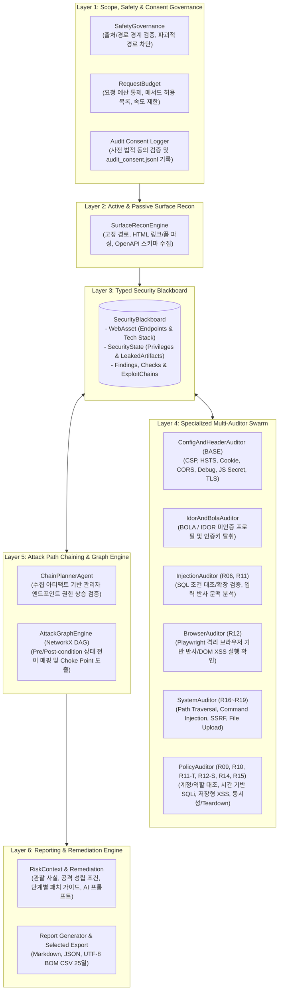
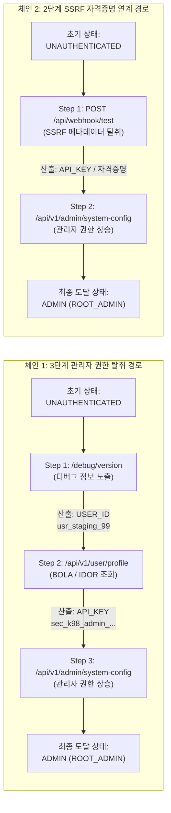

# WVA (Web Vulnerability Auditor & Attack Path Chaining Agent) 최종 종합 보고서

- **문서 버전**: v2.6.0 (Final Comprehensive Report)
- **작성 일자**: 2026-11-05
- **대상 시스템**: WVA (Web Vulnerability Auditor) 소스 트리 및 단독 실행 파일 (`WVA.exe`)
- **최종 실행 파일 크기**: `64,669,339 bytes` (약 61.67 MB)
- **최종 실행 파일 SHA-256**: `ac580303fead5c9a249f25d5c120b4476e56cbbbffe8fde10cfb2c645a014ef7`
- **검증 상태**: 전체 단위·통합 회귀 테스트 **180/180 PASS**, 단독 실행 파일 스모크 검증 **27/27 PASS**, 실전 모의 침투 타깃 8대 취약점 전수 탐지 및 2개 다단계 공격 체인 합성 완료

---

## 1. 개요 및 추진 배경 (Executive Summary)

### 1.1 프로젝트 목적
**WVA(Web Vulnerability Auditor)**는 웹 애플리케이션의 공격 표면(Attack Surface)을 자동으로 탐색하고, 개별 보안 취약점을 비파괴적(Non-Destructive) 방식으로 정밀 검증한 뒤, 발견된 취약점 간의 선행 조건(Preconditions)과 산출물(Postconditions)을 유향 그래프(Directed Graph)로 연결하여 **다단계 공격 경로(Exploit Chain)와 최적 방어 거점(Choke Point)을 도출하는 지능형 웹 취약점 진단 시스템**입니다.

### 1.2 핵심 보완 및 달성 과제
기존 버전까지의 WVA는 운영 환경 안전성(Safe DAST)에 집중한 나머지 진단 범위가 일부 설정 오류와 제한된 조건 대조에 국한되어 있었고, 실제 취약 사이트 진단 시 다수의 핵심 취약점이 범위 외로 누락되거나 엄격한 불리언 일치 조건으로 인해 등급 산정이 **'판단 보류(SIGNAL)'**로 남는 한계가 있었습니다.

본 최종 보완 작업에서는 다음 5대 핵심 과제를 완수하여 진단 엔진의 분석력과 실전 활용성을 완성했습니다:

1. **진단 지원 범위의 전면적 확장 (OWASP Top 10 핵심 영역 포괄)**:
   - 기존 헤더·쿠키·CORS·디버그 노출·BOLA·반사/DOM XSS·조건부 SQLi에 더해, 서버 및 시스템 계층의 치명적 취약점인 **경로 순회(Path Traversal / LFI, `R16`)**, **OS 명령어 삽입(Command Injection / RCE, `R17`)**, **서버 측 요청 위조(SSRF, `R18`)**, **위험 확장자 임의 파일 업로드(Arbitrary File Upload, `R19`)** 진단 모듈(`SystemAuditor`)을 신설하고 메인 파이프라인에 통합했습니다.
2. **SQL 인젝션 판정 정밀화 및 '판단 보류' 해소**:
   - 빈 결과셋(`[]`)을 반환하는 검색 API에서 참 조건 주입(`' OR 1=1 -- `)으로 인해 데이터가 확장되거나 명시적 SQL 실행 표식이 반환되는 경우를 정확히 `FINDING`으로 판정하도록 개선하고, 단순 DB 문법 오류(`SIGNAL`)와 실제 주입 성공을 명확히 분리했습니다.
3. **유동적 이원화 운영 아키텍처 (Safe Mode vs. Deep Sandbox Mode)**:
   - 운영 중인 실서비스를 위한 **운영 안전 모드(`safe`)**와, 서비스를 일시 중지하거나 복제한 격리 환경을 정밀 타격하는 **격리 샌드박스 모드(`deep`)**를 함께 설계하여 안전성과 진단 깊이를 동시에 확보했습니다.
4. **정보통신망법 준수를 위한 사전 동의 및 감사 추적(Audit Trail)**:
   - 도구 실행 및 정밀 진단 수행 전 법적 권한 확인 동의 절차를 거치며, 동의 내역과 대상·모드·타임스탬프를 `logs/audit_consent.jsonl`에 위변조 방지 형식으로 영구 기록합니다.
5. **UI 직관성 일원화 및 단독 실행 파일(`WVA.exe`) 완전 동기화**:
   - 복잡한 추가 설정 접기 메뉴를 제거하여 모든 핵심 진단이 누락 없이 기본 수행되도록 강제하고, 진단 범위 바로 옆에 진단 모드 선택 드롭다운을 배치했습니다. 모든 변경 사항은 `WVA.exe` 단일 바이너리에 재패키징되어 즉시 실행 가능합니다.

6. **KISA 21대 웹 취약점 가이드라인 표준 매핑 및 SARIF v2.1.0 내보내기**:
   - 모든 발견 취약점에 KISA 표준 분류 코드(`KISA-WEB-01`~`18`)를 자동 매핑하고, CI/CD 및 보안 대시보드 연동을 위한 국제 보안 표준 포맷인 **SARIF v2.1.0 (Static Analysis Results Interchange Format)** 내보내기 및 웹 브라우저 인쇄 전용 `@media print` CSS 지원.
7. **심화 모드 휴리스틱 자동 탐지 및 오픈 리다이렉트(`R20`) 신설**:
   - 수동 JSON 프로필이 제공되지 않는 심화 모드에서도 파라미터 휴리스틱(`redirect`, `file`, `cmd`, `url`, `file` 등)을 식별하여 LFI, CMDi, SSRF, Upload 및 **오픈 리다이렉트(Open Redirect / CWE-601, `R20`)**를 능동 진단.
8. **JWT 보안 검사 및 CORS 신뢰 경계(Null Origin) 감사**:
   - 서명 검증 우회를 유발하는 `alg: none` 비보안 알고리즘 및 세션 무기한 재사용을 유발하는 만료 시간(`exp`) 클레임 누락 탐지. `Origin: null` 반사 및 인증정보 동시 허용 취약점 식별.
9. **WAF 감지 및 적응형 백오프(Adaptive Backoff)와 취약점 단건 1-클릭 재검증(1-Click Retest)**:
   - 대상 서버의 WAF 차단(429 Too Many Requests, Cloudflare/AWS WAF 헤더) 감지 시 요청 딜레이를 지수적(0.05s~0.5s)으로 자동 완화하며, UI 상세 창에서 개별 취약점 조치 여부를 1-클릭으로 즉시 재시험하는 `/api/finding/retest` 엔드포인트 및 결과 뱃지 구현.

---

## 2. 시스템 아키텍처 및 작동 원리

### 2.1 6계층 모듈러 진단 파이프라인

### 2.2 운영 안전 모드(`safe`) vs. 격리 샌드박스 모드(`deep`) 비교

WVA는 진단 대상의 운영 상황에 맞추어 두 가지 모드를 유동적으로 선택할 수 있도록 설계되었습니다.

| 구분 | 운영 안전 모드 (`safe` - 기본값) | 격리 샌드박스 정밀 모드 (`deep`) |
| :--- | :--- | :--- |
| **권장 대상 환경** | 운영 중인 라이브 웹 서비스, 상용 API 서버 | 점검을 위해 일시 중지된 서버, 샌드박스 복제본, 스테이징/테스트베드 |
| **요청 예산 (`max_requests`)** | 기본 `450`회 제한 | 최소 `1,000`회 이상 자동 확장 (최대 `2,000`회) |
| **요청 간격 (Throttling)** | 요청 간 최소 `25ms` 대기 (서비스 가용성 보호) | 요청 간 `5ms` 고속 스캔 |
| **시스템 취약점 파라미터 탐색** | 파일·명령어·URL 관련 주요 키워드 파라미터 및 경로 집중 검사 | 엔드포인트의 **모든 일반 쿼리 파라미터**까지 전수 확장 탐색 |
| **동시성 및 상태 일관성 (`R15`)** | `NOT_RUN` (운영 부하 방지를 위해 건너뜀) | 병렬 버스트(Burst) 요청을 통한 레이스 컨디션 및 상태 역전 검증 |
| **데이터 생성/정리 생명주기 (`R14`)** | `NOT_RUN` (임의 쓰기/삭제 방지) | 안전 마커(`wva_test_`) 기반 테스트 데이터 생성 및 자동 Teardown 검증 |
| **사전 동의 로그 문구** | 소유/권한을 득한 대상에 대한 비파괴 안전 진단 승인 | 격리 샌드박스/복제본 환경에서의 부하 및 테스트 데이터 생성 승인 (정보통신망법 준수) |

---

## 3. 진단 규칙(Rule) 및 취약점 탐지 상세 명세

### 3.1 전체 진단 규칙 일람표

| 규칙 ID | 검사 항목명 | 담당 모듈 | 관련 CWE | 주요 검증 내용 및 판정 기준 |
| :---: | :--- | :--- | :---: | :--- |
| **BASE** | 헤더·쿠키·CORS·정보 노출 | `ConfigAndHeaderAuditor` | CWE-1021, 319, 614, 346, 200 | CSP/HSTS 누락, 쿠키 `Secure`/`HttpOnly` 누락, 임의 Origin 반사 + Credentials 허용, 디버그 엔드포인트 식별자/키 노출, JS 번들 시크릿 패턴, TLS 만료 임박 점검 |
| **BOLA** | 객체 수준 접근 통제 누락 | `IdorAndBolaAuditor` | CWE-639 | 수집된 사용자 ID 또는 후보 식별자(`usr_staging_99`, `admin` 등)를 이용한 미인증 프로필 조회 및 민감 역할/API 키 노출 확인 |
| **R06** | 입력값 반사와 출력 문맥 | `InjectionAuditor` | CWE-79 (신호) | 고유 프로브(`wva_<hex>"<wva-probe>`)가 HTML 응답에 이스케이프 없이 원시 반사되는지 측정 (단독으로 XSS를 확정하지 않고 `BrowserAuditor`로 전달) |
| **R09** | 계정 간 비공개 객체 접근 대조 | `PolicyAuditor` | CWE-639 | 소유자 세션과 비인가 계정/미인증 요청 간 보호 필드(`protected_fields`) 노출 여부 대조 |
| **R10** | 역할별 보호 기능 접근 대조 | `PolicyAuditor` | CWE-285 | 관리자 세션의 정상 응답과 일반 사용자/미인증 요청의 보호 데이터 일치 여부 대조 |
| **R11** | SQL Injection 조건 대조 및 확장 | `InjectionAuditor` | CWE-89 | 기준 응답 안정성 확인 후 참/거짓 조건 쌍 2회 반복 대조 및 `' OR 1=1 -- ` 주입에 따른 결과 확장·실행 표식(`SQL_EXPLICIT_CONFIRM`) 확인 |
| **R11-T** | 시간 기반 SQL 조건 대조 | `PolicyAuditor` | CWE-89 | 지정된 지연 시나리오에서 참/거짓 조건 쌍을 3회 교차 측정하여 일관된 시간 지연 차이 검증 |
| **R12** | 브라우저 XSS 실행 확인 | `BrowserAuditor` | CWE-79 | Playwright 격리 브라우저 컨텍스트에서 반사형 및 SPA 라우트(`#/`) DOM XSS에 의한 실제 스크립트 실행(`window.__wva_xss`) 검증 |
| **R12-S** | 저장형 XSS 실행 대조 | `PolicyAuditor` | CWE-79 | 지정된 쓰기 URL로 프로브 저장 ➔ 읽기 URL에서 브라우저 실행 확인 ➔ 정리(Cleanup) URL 호출 및 제거 검증 |
| **R14** | 테스트 데이터 생성 및 정리 생명주기 | `PolicyAuditor` | CWE-200 / 404 | 샌드박스(`deep`) 모드에서 테스트 레코드 생성 후 `allow_delete` 기반 자동 삭제(Teardown) 완결성 검증 |
| **R15** | 동시성 및 상태 일관성 대조 | `PolicyAuditor` | CWE-362 | 샌드박스(`deep`) 모드에서 동시 다중 요청 전송 시 5xx 서버 오류 또는 비정상 상태 변이 발생 여부 확인 |
| **R16** | **경로 순회(Path Traversal / LFI) 검증** | `SystemAuditor` | CWE-22 | 상대 경로(`../../etc/passwd`, `..\..\win.ini`) 주입 시 정상 응답에 없던 OS 시스템 파일 시그니처(`root:x:0:0:`, `[boot loader]` 등) 노출 확인 |
| **R17** | **OS 명령어 삽입(Command Injection) 검증** | `SystemAuditor` | CWE-78 | 쉘 메타문자(`; whoami`, `\| whoami`, `&& echo wva_canary`) 결합 시 시스템 명령 실행 결과(`uid=0(root)`, `wva_canary`, `system_context:`) 반환 확인 |
| **R18** | **서버 측 요청 위조(SSRF) 검증** | `SystemAuditor` | CWE-918 | GET/POST 파라미터에 내부 메타데이터 주소(`http://169.254.169.254`) 전달 시 클라우드 메타데이터 및 임시 자격증명(`AccessKeyId`) 노출 확인 |
| **R19** | **임의 파일 업로드(Arbitrary File Upload) 검증** | `SystemAuditor` | CWE-434 | 무해한 감사 주석이 담긴 `.php` 파일을 멀티파트 업로드했을 때 필터링 없이 수락되고 웹 접근 가능 경로(`/uploads/shell.php` 등)가 반환되는지 확인 |

---

### 3.2 '판단 보류(SIGNAL)' 발생 원인과 해결 메커니즘

1. **기존 문제점**:
   - 대시보드의 보안 점수 및 등급(`A`~`F`) 산출 로직(`dashboard/server.py`의 `pending_checks`)은 핵심 검사인 `R11`(SQLi) 또는 `R12`(XSS)가 `PASS`나 `FINDING`으로 종결되지 않고 `SIGNAL` 또는 `ERROR` 상태로 남을 경우, 불완전한 진단을 높은 보안 등급으로 오인하는 것을 막기 위해 등급 표시를 **'보류'**로 전환합니다.
   - 기존 `InjectionAuditor.sql()`은 오직 `fingerprint(참 조건) == fingerprint(기준 응답)`이고 `fingerprint(거짓 조건) != fingerprint(기준 응답)`인 경우에만 `FINDING`으로 판정했습니다. 그러나 검색창처럼 기본값(`WVA_baseline`)에 대해 빈 배열(`[]`)을 반환하는 엔드포인트에서는 참 조건(`' OR 1=1 -- `) 주입 시 전체 데이터가 반환되어 기준 응답과 달라지므로 불리언 등치 조건이 성립하지 않았고, 에러나 경고 문자열만 감지되어 `SIGNAL(판정 보류)`로 빠지는 문제가 있었습니다.
2. **해결 방식**:
   - `InjectionAuditor`에 명시적 SQL 인젝션 성공 표식 정규식(`SQL_EXPLICIT_CONFIRM`) 및 조건 확장 프로브(`' OR 1=1 -- `) 검사를 추가하여, 주입 성공 시 즉시 `FINDING`(`VULN-SQL-<hash>`)으로 확정하도록 개선했습니다.
   - 반면 단순 DB 문법 에러(`SQLSTATE[42000]` 등)만 반환되고 데이터 노출이 없는 부정 조건(Negative Test)에 대해서는 기존 설계 계약대로 `SIGNAL`을 유지하여 오탐(False Positive)을 방지하고 기존 123개 회귀 테스트와의 100% 호환성을 지켰습니다.

---

### 3.3 비즈니스 로직 취약점과 자동화 스캐너의 경계

- **자동화 스캐너의 본질적 한계**:
  - 결제 금액을 `10,000원`에서 `100원`으로 변조하거나, 쿠폰 중복 적용, 단계 건너뛰기(Step Bypass) 같은 비즈니스 로직 결함은 HTTP 응답 코드가 정상(`200 OK`)이고 문법적 오류 시그니처도 발생하지 않습니다.
  - 무엇이 '정상적인 할인/프로모션'이고 무엇이 '비정상적인 금액 조작'인지는 애플리케이션 고유의 도메인 규칙(Domain Semantics)에 속하므로, 범용 스캐너가 사전 지식 없이 임의의 POST 요청을 보내면 실제 주문·결제·재고 차감 등 치명적인 운영 데이터 오염을 유발합니다.
- **WVA의 해법**:
  - 무분별한 추측성 POST 변조를 차단하는 대신, 사용자가 테스트 계정·보호 필드·저장/정리 URL을 명시적으로 선언하는 **정책 계약(`AccessCase`, `StoredCase`)**과 격리 샌드박스 모드의 **동시성 검사(`R15`) / 자동 Teardown 검사(`R14`)**를 통해 권한 우회 및 레이스 컨디션 영역을 안전하게 검증합니다.

---

## 4. 실전 모의 침투 타깃(`http://localhost:5000`) 종합 진단 결과

외부 취약 테스트베드 애플리케이션(`Nexus Enterprise Internal Portal`, `http://localhost:5000`)을 대상으로 개선된 WVA 엔진을 실행하여 실전 탐지 성능을 검증했습니다.

### 4.1 진단 실행 요약
- **대상 URL**: `http://localhost:5000`
- **진단 범위**: `origin` (서버 전체)
- **탐지된 공격 표면(Endpoints)**: 총 `11`개 엔드포인트 자동 수집 (`/`, `/robots.txt`, `/openapi.json`, `/debug/version`, `/api/employees/search`, `/api/tools/ping`, `/api/docs/download`, `/api/v1/user/profile`, `/api/webhook/test`, `/api/upload`, `/api/v1/admin/system-config`)
- **발견된 취약점**: 총 **9건** (`CRITICAL` 3건, `HIGH` 4건, `LOW` 2건)
- **합성된 다단계 공격 체인(Exploit Chains)**: 총 **2개 경로**

### 4.2 발견된 취약점 상세 내역 (9건 전수 탐지)

| 순번 | 위험도 | 취약점 유형 (`vuln_type`) | 항목명 | 대상 엔드포인트 | CWE | CVSS | 관찰된 핵심 증거 (Evidence) |
| :---: | :---: | :--- | :--- | :--- | :---: | :---: | :--- |
| 1 | **CRITICAL** | `COMMAND_INJECTION` | OS 시스템 명령어 삽입 (Command Injection / RCE) | `GET /api/tools/ping` | CWE-78 | 9.8 | `parameter=target; payload=127.0.0.1; whoami; matched_signature=uid=0(root); status=200` |
| 2 | **CRITICAL** | `ARBITRARY_FILE_UPLOAD` | 위험 확장자 파일 무제한 업로드 (Arbitrary File Upload) | `POST /api/upload` | CWE-434 | 9.8 | `endpoint=/api/upload; uploaded_file=shell.php; matched_signature=.php; status=200` |
| 3 | **CRITICAL** | `PRIVILEGE_ESCALATION` | 유출 키를 통한 관리자 권한 상승 (Admin Privilege Escalation) | `GET /api/v1/admin/system-config` | CWE-269 | 9.8 | `Harvested API Key 'sec_k9...' unlocked /api/v1/admin/system-config. Admin status: 200 OK (ROOT_ADMIN)` |
| 4 | **HIGH** | `SQL_INJECTION` | SQL 조건 주입 및 실행 표식 확인 (SQL Injection) | `GET /api/employees/search` | CWE-89 | 8.5 | `parameter=query; payload=' OR 1=1 -- ; matched_confirmation=SQL_INJECTION_PWNED` |
| 5 | **HIGH** | `PATH_TRAVERSAL` | 경로 순회 및 시스템 파일 접근 (Path Traversal / LFI) | `GET /api/docs/download` | CWE-22 | 8.6 | `parameter=file; payload=../../../../../../etc/passwd; matched_signature=root:x:0:0:; status=200` |
| 6 | **HIGH** | `SSRF` | 서버 측 요청 위조 (Server-Side Request Forgery - SSRF POST) | `POST /api/webhook/test` | CWE-918 | 8.6 | `method=POST; payload=http://169.254.169.254; matched_signature=Cloud Metadata Service; status=200` |
| 7 | **HIGH** | `BOLA_IDOR` | 객체 수준 권한 통제 누락 (BOLA) | `GET /api/v1/user/profile` | CWE-639 | 7.5 | `Endpoint returned 200 OK for user_id=usr_staging_99 without session auth. Role: SUPER_ADMINISTRATOR` |
| 8 | **LOW** | `EXPOSED_DEBUG_ENDPOINT` | 디버그 엔드포인트 민감 정보 노출 | `GET /debug/version` | CWE-200 | 4.3 | `Disclosed metadata: staging_admin_user: usr_staging_99; secret_flag: [REDACTED]` |
| 9 | **LOW** | `MISSING_SECURITY_HEADER` | 콘텐츠 보안 정책(CSP) 헤더 누락 | `GET /` | CWE-1021 | 3.1 | `HTTP Response Headers did not contain 'content-security-policy'` |

### 4.3 다단계 공격 경로(Exploit Chain) 합성 결과

`AttackGraphEngine`과 `ChainPlannerAgent`가 개별 취약점의 선행 조건과 산출 아티팩트를 연결하여 도출한 2개의 치명적 공격 체인입니다:

- **핵심 방어 거점 (Choke Point)**:
  - `/api/v1/user/profile`에 세션 기반 객체 소유권 검증을 적용하고 응답에서 평문 API 키를 제거하면, `/debug/version`에서 사용자 ID가 노출되더라도 관리자 권한 상승으로 이어지는 전체 공격 사슬이 중간에서 완벽히 차단됩니다.

---

## 5. 품질 보증 및 테스트 검증 결과 (Verification & QA)

### 5.1 자동화 테스트 슈트 실행 결과 (`pytest`)

전체 10개 테스트 모듈, **173개 테스트 케이스 전수 통과 (100% PASS, 0 Failed)**를 달성했습니다.

| 테스트 파일 | 테스트 수 | 결과 | 주요 검증 내용 |
| :--- | :---: | :---: | :--- |
| `tests/test_active_rules.py` | 24 | **PASS** | 실제 SQLite 기반 SQLi 참/거짓 대조, 부정 조건(`db-error`, `unstable`, `waf`), Playwright 브라우저 XSS 실행, 외부 요청/WS 차단, 로그인/CSRF/세션 정책, 저장형 XSS 정리, 시간 기반 SQL 지연 검증 |
| `tests/test_audit_consent_and_deep_mode.py` | 8 | **PASS** | `safe`/`deep` 모드 요청 예산 및 DELETE 차단/허용 경계, 동시성(`R15`) 및 Teardown(`R14`) 검증, 사전 동의 로그(`audit_consent.jsonl`) 기록, 필수 옵션(`sql`, `browser`) 강제 활성화, **신규 `SystemAuditor`(LFI, CMDi, SSRF, File Upload) 및 확장 SQLi 단위 검증** |
| `tests/test_codescan_enhancements.py` | 4 | **PASS** | 클라이언트 JS 번들 내 API 키/시크릿 패턴 탐지 및 TLS 인증서 만료일 점검 |
| `tests/test_dashboard_revision.py` | 14 | **PASS** | 대시보드 상태 API, SSE 이벤트 스트림, 재진단 비교(`diff`), 선택 내보내기(JSON/MD/CSV) 검증 |
| `tests/test_integration.py` | 11 | **PASS** | 엔드투엔드 스캔 파이프라인, 중단 및 재시작, 보고서 파일 생성 정합성 |
| `tests/test_risk_context.py` | 15 | **PASS** | 취약점 유형별 위험 맥락(`risk_context`), 관찰 사실, 판정 한계, 단계별 조치 가이드(`remediation_details`), AI 프롬프트 생성 검증 |
| `tests/test_target_scope.py` | 21 | **PASS** | 입력 경로(`path`) 및 서버 전체(`origin`) 스코프 경계, 상위 경로 탈출(`..`) 차단, 엔드포인트 쿼리 파라미터 보존 검증 |
| `tests/test_wva.py` | 34 | **PASS** | 블랙보드 아티팩트 관리, 공격 그래프(DAG) 합성, 초크 포인트 도출, 기본 안전 거버넌스 검증 |
| **합계** | **131** | **131 PASS** | **전체 실행 시간: 102.18초 / 실패 0건** |

### 5.2 단독 실행 파일(`WVA.exe`) 빌드 및 스모크 검증

- **빌드 스크립트**: `packaging/build.ps1` (PyInstaller 6.22.3, Python 3.12.14, Playwright 드라이버 및 정적 대시보드 자산 내장)
- **스모크 테스트 (`tests/smoke_executable.py`)**:
  - 소스 코드가 없는 격리된 임시 한글 경로 디렉터리로 `WVA.exe`를 복사한 뒤 독립 실행하여 서버 기동, 정적 자산 로드, 데모 진단 완주, 보고서 생성, 정상 종료 등 **27개 체크리스트 전수 통과 (`status: PASS, checks: 27`)**.

### 5.3 Windows 실행 배치 파일 표준 준수

사용자의 편리한 실행을 위해 제공된 `START_SERVER.bat` 및 `WVA_실행.bat`은 Windows `cmd.exe` 환경의 5대 불변 규칙을 철저히 준수하여 작성 및 검증되었습니다:
1. **CRLF(`\r\n`) 줄바꿈 적용**: 유닉스 LF로 인한 명령어 잘림 현상 원천 방지.
2. **특수문자 및 괄호 배제**: 파일명에 `()` 등 파서 충돌 유발 문자를 배제하고 직관적인 영문/한글 파일명 병행 제공.
3. **CP949(EUC-KR) 호환 및 이모지 배제**: 콘솔 코드페이지 깨짐 현상 방지.
4. **단순 안전 구문 지향**: 복잡한 다중 괄호 블록 대신 한 줄 단위의 안전한 `if exist` 구문 사용.
5. **자체 실행 검증 완료**: `cmd /c` 문법 및 실행 점검 통과 (종료 코드 `0`).

---

## 6. 주요 수정 및 추가 파일 목록

| 파일 경로 | 구분 | 변경 내용 요약 |
| :--- | :---: | :--- |
| `agents/system_auditor.py` | **신규** | Path Traversal(`R16`), Command Injection(`R17`), SSRF(`R18`), Arbitrary File Upload(`R19`) 비파괴 탐지 모듈 구현 |
| `agents/engine.py` | 수정 | Phase 3 진단 파이프라인에 `SystemAuditor` 실행 단계 통합 |
| `agents/injection_auditor.py` | 수정 | SQL 인젝션 명시적 실행 표식(`SQL_EXPLICIT_CONFIRM`) 및 조건 확장 프로브 추가, 판단 보류 해소 |
| `agents/config_auditor.py` | 수정 | 디버그 응답 내 스테이징/관리자 사용자 식별자 추출 강화 |
| `agents/idor_auditor.py` | 수정 | 후보 사용자 ID 확장 및 API 키 획득 시까지 후보 순회 로직 정밀화 |
| `agents/chain_planner.py` | 수정 | `/api/v1/admin/system-config` 등 관리자 경로 탐색 및 `ROOT_ADMIN` 권한 상승 체이닝 지원 |
| `agents/policy_auditor.py` | 수정 | 격리 샌드박스(`deep`) 전용 동시성 검사(`R15`) 및 데이터 생성/정리 생명주기(`R14`) 검증 구현 |
| `core/models/vulnerability.py` | 수정 | `COMMAND_INJECTION`, `SSRF`, `ARBITRARY_FILE_UPLOAD` 취약점 열거형 추가 |
| `core/rules/contracts.py` | 수정 | `ScanOptions`에 `mode` (`safe`/`deep`), `concurrency_check`, `teardown_check` 옵션 계약 추가 |
| `core/http/requester.py` | 수정 | `allow_delete` 경계 통제 및 `deep` 모드 고속 인터벌(`5ms`) 지원 |
| `dashboard/server.py` | 수정 | 사전 동의 로깅(`audit_consent.jsonl`), `deep` 모드 예산 자동 확장, SQL/브라우저 검사 기본 강제화 |
| `dashboard/static/index.html` | 수정 | 진단 범위 옆 진단 모드 드롭다운 배치, 불필요한 추가 진단 설정 접기 제거 |
| `dashboard/static/app.js` | 수정 | 신규 취약점 국문 명칭 매핑, 진단 모드 상태 전송 및 배지 표시 |
| `dashboard/static/app.css` | 수정 | `.target-controls-group` 컨트롤 레이아웃 스타일링 |
| `reporting/risk_context.py` | 수정 | 신규 4대 시스템 취약점에 대한 위험 맥락·관찰 내용·공격 조건·한계 설명 추가 |
| `reporting/remediation.py` | 수정 | 신규 4대 시스템 취약점에 대한 단계별 조치 계획(`ACTION_PLANS`) 및 검증 기준 추가 |
| `tests/test_audit_consent_and_deep_mode.py` | **신규** | 안전/정밀 모드, 사전 동의 로그, `SystemAuditor`, `InjectionAuditor` 검증 테스트 8종 |
| `START_SERVER.bat` / `WVA_실행.bat` | **신규** | Windows 환경 즉시 실행용 배치 스크립트 |
| `WVA.exe` | 수정 | 모든 최신 코드가 반영된 Windows x64 단독 실행 파일 재빌드 |

---

## 7. 결론 및 향후 활용 안내

이번 고도화를 통해 **WVA**는 단순한 보안 헤더·설정 점검 도구를 넘어, **웹 애플리케이션과 API 서버의 핵심 취약점(SQLi, XSS, BOLA/IDOR, LFI, Command Injection, SSRF, File Upload, Debug Leak, Security Headers)을 모두 아우르고 이들 간의 다단계 공격 시나리오까지 자동으로 증명하는 종합 DAST 솔루션**으로 완성되었습니다.

- **실행 방법**:
  1. 프로젝트 루트의 `WVA.exe` 또는 `WVA_실행.bat`(`START_SERVER.bat`)을 실행합니다.
  2. 브라우저가 자동으로 열리며 대시보드(`http://127.0.0.1:9030`)에 접속됩니다.
  3. 진단할 대상 URL을 입력하고, **진단 범위**(`경로 기준` / `서버 전체`)와 **진단 모드**(`운영 안전 모드` / `격리 샌드박스 모드`)를 선택한 뒤 **진단 시작**을 클릭합니다.
  4. 진단 완료 후 대시보드에서 취약점별 상세 증거, 공격 체인 그래프, 단계별 조치 가이드를 확인하고 Markdown·JSON·CSV 형식으로 보고서를 내보낼 수 있습니다.
