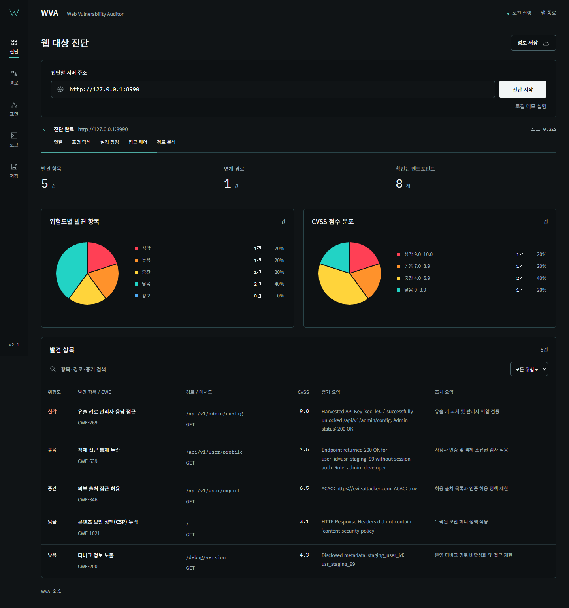

# WVA · 웹 취약점 진단

Windows 실행파일과 로컬 브라우저로 사용하는 웹 진단 도구입니다. **직접 입력한 대상 진단 → 증거 확인 → 연계 경로 검토 → 보고서 저장**을 기본 흐름으로 제공합니다.



화면은 제공된 로컬 실습 대상을 진단한 결과입니다. 현재 검증된 Windows 실행파일 `WVA.exe`를 저장소에 포함하며, 빌드 해시와 테스트 기록은 `docs/BUILD_INFO.json` 및 `tests/TEST_GUIDE.md`에서 확인할 수 있습니다.

## 바로 실행

1. 이 폴더의 **`WVA.exe`**를 더블클릭합니다. Python을 따로 설치할 필요가 없습니다.
2. 브라우저에서 진단할 서버 주소를 입력합니다. 예: 로컬 실습 대상 `http://127.0.0.1:8990`.
3. **진단 시작**을 누릅니다. 진행 모션 후 완료되면 위험도·CVSS 차트와 상세 표가 표시됩니다. 발견 항목을 누르면 큰 상세 창에서 증거와 조치 절차를 확인합니다.
4. **경로 / 표면 / 로그** 메뉴에서 관련 정보를 확인합니다.
5. **저장** 화면에서 원하는 정보와 **JSON / Markdown / CSV** 형식을 선택해 내려받습니다.
6. **앱 종료**로 서비스를 종료합니다. 브라우저 탭만 닫으면 서버는 계속 실행됩니다.

기본 주소는 `http://127.0.0.1:9030`입니다. 포트가 사용 중이면 9031~9039 중 가능한 포트로 열립니다. 이미 실행 중인 WVA가 있으면 해당 화면을 재사용합니다. 포트를 지정할 수도 있습니다.

```powershell
.\WVA.exe --port 9040
```

새 실행파일은 대시보드, 한글/숫자 폰트, 로컬 데모를 포함합니다. 외부 CDN 없이 동작합니다. 어두운 배경·흰 글씨·청록색 선을 사용하고 직접 진단을 기본 작업으로 구성했습니다. 이전 배치 실행기 6개는 삭제했습니다.

## 테스트

테스트 환경 `.venv/`와 `tests/`가 구성되어 있습니다. 상세한 실행 순서, 기대 수치, 판정 기준, 실제 결과보고서는 **[테스트 상세 설명](tests/TEST_GUIDE.md)** 한 파일에서 볼 수 있습니다.

```powershell
# 다른 PC에서 환경을 구축할 때
powershell -ExecutionPolicy Bypass -File .\tests\Setup-TestEnvironment.ps1

# 자동 기능 테스트 및 결과보고서 갱신
.\.venv\Scripts\python.exe -m tests.run_tests

# 직접 입력할 로컬 취약 대상: 별도 창에서 실행
.\.venv\Scripts\python.exe -m tests.lab.target --mode vulnerable --port 8990

# 방어 설정을 적용한 비교 대상: 다른 창에서 실행
.\.venv\Scripts\python.exe -m tests.lab.target --mode hardened --port 8991
```

제공된 취약 대상의 예상 결과는 엔드포인트 8개, 발견 항목 5개, 3단계 연계 경로 1개입니다. 방어 프로필은 엔드포인트 4개, 발견 항목과 연계 경로 0개입니다. 수동 대상은 테스트 후 `Ctrl+C`로 종료합니다. 화면의 **로컬 데모 실행**은 임시 포트의 실습 대상을 자동으로 시작하고 정리합니다.

## 저장 위치와 오류 확인

- 완료 보고서: exe 옆 `reports/날짜_시간_진단ID.md` 및 `.json`.
- 진단별 활동 로그: exe 옆 `logs/scans/날짜_시간_진단ID.jsonl` (실시간 추가 기록).
- 실행 오류 로그: exe 옆 `logs/WVA.log`. 두 위치는 **로그** 화면에서 확인합니다.
- 해당 위치에 쓰기 권한이 없으면 `%LOCALAPPDATA%/WVA/` 아래를 사용합니다.
- 진단 실패·중단은 완료와 구분하고 완료 보고서 다운로드를 막습니다.
- 앱 재실행 시 화면 데이터는 초기화되며, 저장된 파일은 남습니다.

2.1 화면 구성: 진단 화면의 공통 설명 멘트·우선 조치 패널을 없앴습니다. 차트 아래 표에는 위험도·CWE·메서드·CVSS·증거·조치 요약이 표시됩니다. 경로 단계와 발견 항목은 같은 상세 창을 사용하며 현재 화면을 유지합니다. 표면 화면은 실제 응답 코드·시간·크기·헤더와 문서의 매개변수 정보를 구분해 표시합니다. 저장 화면은 요약·발견 항목·경로·표면·로그를 독립적으로 선택할 수 있습니다.

권고사항은 항목별 **조치 순서**로 정리합니다. 각 단계에 제목·실행할 조치·완료 기준이 있으며, 실제 순서는 문제 유형에 따라 다릅니다. 예를 들어 유출 키로 관리자 응답에 접근한 항목은 현황 확인 → 유출 키·접근 차단 → 관리자 권한 검사 → 새 인증 정보 발급 → 상위 노출 경로 정리 → 재검증 순서입니다. 상세 창, 선택 저장(JSON·Markdown·CSV), 자동 보고서에 같은 순서를 제공합니다.

`[Errno 42] Illegal byte sequence`가 발생한 초기 빌드는 교체했습니다. Python 런타임이 요구하는 TLS 인증서 정책 파일을 포함하고, 한글 경로에서 exe만 복사한 독립 실행을 검증합니다. 자세한 실제 결과는 테스트 문서에 기록됩니다.

## 소스 실행과 재빌드

```powershell
.\.venv\Scripts\python.exe launcher.py
powershell -ExecutionPolicy Bypass -File .\packaging\build.ps1
.\.venv\Scripts\python.exe -m tests.smoke_executable
```

테스트용 고정 버전은 `requirements-lock.txt`, 런타임 의존성 목록은 `requirements.txt`에 있습니다. 빌드 스크립트가 루트의 exe를 재생성하므로 빌드 전 실행 중인 앱을 종료하세요.

## 분석 범위

헤더·디버그 정보·제한된 객체 접근·CORS·수집 키의 관리자 응답을 정해진 경로와 휴리스틱으로 검사합니다. 연계 경로는 관찰된 응답과 아티팩트 유형을 연결한 추론입니다. 제공되는 차단점은 각 단계의 수정 후보입니다.

이 도구는 전체 URL 크롤러, 모든 OWASP 항목 검사기, 로그인 세션 간 권한 대조 도구, 최소 비용 방어 최적화 엔진이 아닙니다. JSON은 자체 WVA 스키마이며 SARIF 형식이 아닙니다. 결과 0건이 전체 웹 보안의 안전을 의미하지 않습니다. 접근 권한이 있는 대상에서 사용하세요.

## 주요 파일

| 위치 | 내용 |
| --- | --- |
| `WVA.exe` | Windows x64 단독 실행파일 |
| `launcher.py` | 브라우저 열기·서버 재사용·포트 선택·쓰기 위치 |
| `dashboard/` | API·스캔 상태·로컬 UI·내장 데모 수명 관리 |
| `agents/`, `core/`, `surface/`, `reporting/` | 기존 분석 엔진과 보완된 진단 규칙 |
| `tests/TEST_GUIDE.md` | 테스트 순서·예상 결과·실제 결과 통합 문서 |
| `tests/TEST_RESULTS.md` | 별도 결과보고서 |
| `tests/lab/` | 취약/방어 비교 환경 |
| `packaging/` | exe 빌드 스크립트와 아이콘 |
| `docs/PROJECT_ANALYSIS.md` | 폴더 분석·변경 내역·구현 범위 |
| `docs/REMOVED_LAUNCHERS.md` | 삭제한 이전 실행기와 해시 |
| `PRODUCT.md`, `DESIGN.md` | 사용자 요구와 디자인 결정 |

기존 `WVA_설계계획서_최종본.md`, `WVA_SYSTEM_DESIGN_SPECIFICATION.md`는 초기 설계 참고 자료입니다. 현재 구현과 검증 상태는 이 README 및 테스트 결과를 기준으로 확인하세요.
