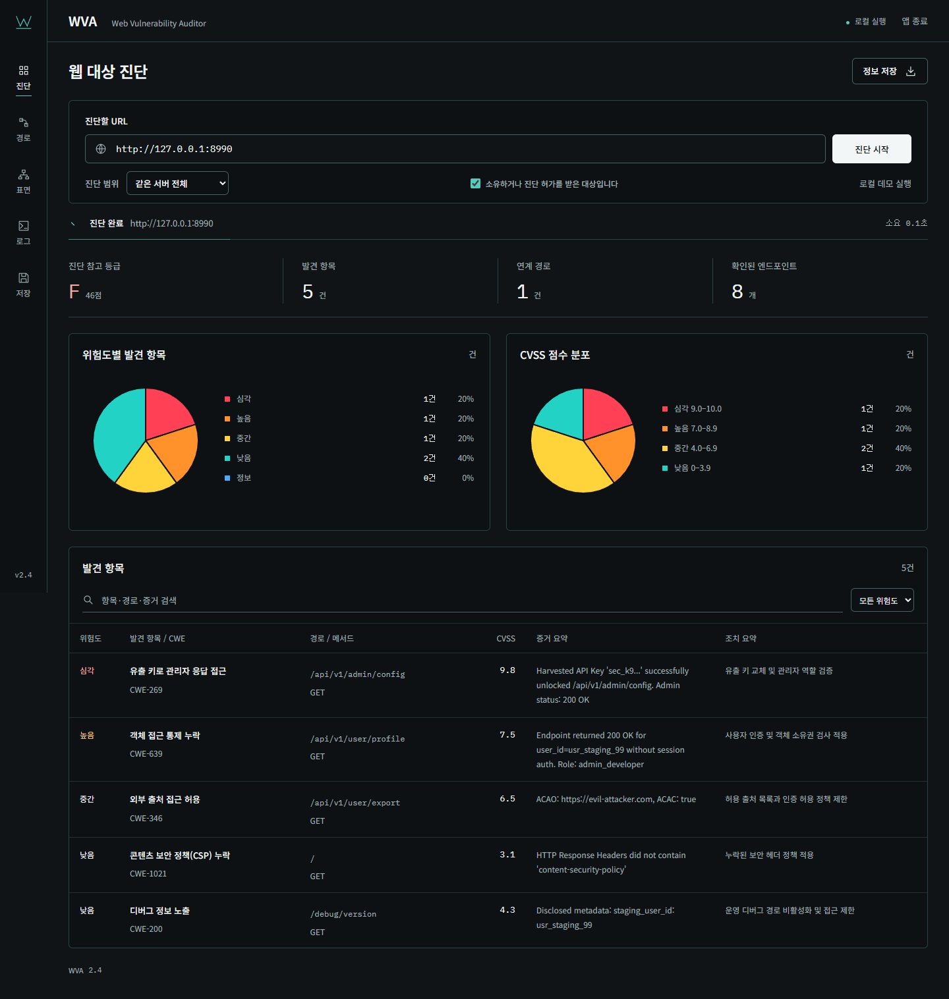
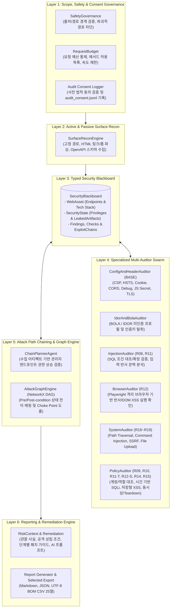
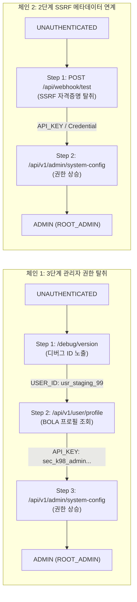

# WVA (Web Vulnerability Auditor)

> **지능형 웹 취약점 진단 및 다단계 공격 체인 분석 에이전트**
> (Web Vulnerability Auditor & Attack Path Chaining Agent)

[](docs/BUILD_INFO.json)
[](tests/TEST_RESULTS.md)
[](tests/TEST_RESULTS.md)
[](WVA.exe)



2.7 변경: 발견 기준 참고 등급과 검사 완료 여부 분리, 재진단 비교 근거 표시, 대표 SQL 매개변수 대조, 미인증 설정·Git·관리 환경 노출 검사, 확대 가능한 체인 그래프. 계정 프로필은 로그인 검사에만 선택합니다. [변경 내용·재현 절차·한계](docs/WORKFLOW_UPGRADE_2.7.md).

화면은 제공된 로컬 실습 대상을 진단한 결과입니다. 현재 검증된 Windows 실행파일 `WVA.exe`를 저장소에 포함하며, 빌드 해시와 테스트 기록은 `docs/BUILD_INFO.json` 및 `tests/TEST_GUIDE.md`에서 확인할 수 있습니다.

---

## 1. 주요 특징 (Key Features)

1. **OWASP Top 10 핵심 취약점 전면 지원**:
   - SQL Injection (조건 대조 및 확장 탐지, `R11`)
   - Cross-Site Scripting (Playwright 격리 브라우저 기반 실제 DOM/반사 XSS 실행 확인, `R12`)
   - Broken Object Level Authorization (BOLA/IDOR 미인증 객체 조회 및 키 탈취)
   - 경로 순회 / 로컬 파일 열람 (Path Traversal / LFI, `R16`)
   - OS 시스템 명령어 삽입 (Command Injection / RCE, `R17`)
   - 서버 측 요청 위조 (Server-Side Request Forgery - SSRF, `R18`)
   - 위험 확장자 임의 파일 업로드 (Arbitrary File Upload, `R19`)
   - 오픈 리다이렉트 (Open Redirect / CWE-601, `R20`)
   - JWT 보안 점검 (`alg: none`, `exp` 누락) 및 CORS `Origin: null` 비인가 신뢰 감사
   - 보안 헤더(CSP, HSTS) 누락, 쿠키 플래그 결여, CORS Origin 반사, 디버그 엔드포인트 정보 노출, 클라이언트 JS 시크릿 패턴, TLS 인증서 만료 임박 점검(`BASE`)
   - 계정·역할별 비공개 객체 접근 정책 대조 (`R09`, `R10`), 저장형 XSS 정리 완결성 (`R12-S`), 시간 기반 SQLi (`R11-T`)
2. **유동적 이원화 진단 모드 (`safe` vs `deep`)**:
   - **운영 안전 모드 (`safe`)**: 실제 서비스 중인 환경을 위해 비파괴 읽기 전용 카나리 프로브와 요청 속도 제한(Throttling 25ms)을 적용하여 서비스 가용성을 완벽히 보호.
   - **심화 모드 (Deep DAST) (`deep`)**: 원격 스테이징/점검 중인 서버나 격리 환경을 위해 고속 스캔(5ms), 전수 파라미터 탐색, 동시성/레이스 컨디션 검증(`R15`), 안전 마커(`wva_test_`) 기반 테스트 데이터 생성 및 자동 삭제(Teardown) 생명주기 검증(`R14`) 지원.
3. **2.6 판정 신뢰성 및 엄격한 증거 검증 (`docs/RELIABILITY_UPGRADE_2.6.md`)**:
   - 단순 성공 설명 문구, 입력 반사, 업로드 거절을 취약점으로 확정하던 분기를 제거하고 명확한 독립 증거 계약을 적용.
   - 필수 검사에 미실행·오류·미확정이 있는 경우 불완전한 결과를 높은 등급으로 오인하지 않도록 참고 등급을 자동으로 '보류(SIGNAL)' 처리.
4. **법적 책임 및 정보통신망법 준수 감사 추적 (Audit Trail)**:
   - 진단 시작 전 소유권 및 권한 동의 절차를 필수로 수행하며, 타임스탬프·대상 URL·진단 모드·동의 문구를 `logs/audit_consent.jsonl`에 영구 기록.
5. **다단계 공격 체인 합성 및 방어 초크 포인트 도출**:
   - NetworkX 기반 `AttackGraphEngine`이 디버그 정보 노출 ➔ BOLA 키 탈취 ➔ 관리자 권한 상승으로 이어지는 다단계 익스플로잇 체인을 자동 합성하고, 최소 비용으로 전체 사슬을 끊는 패치 위치(Choke Point) 제시.
6. **무설치 단독 실행 파일 (`WVA.exe`)**:
   - Python 환경 설치 없이 더블클릭만으로 브라우저 대시보드와 진단 엔진이 즉시 기동되는 올인원 패키지.

---

## 2. 바로 실행하기 (Quick Start)

### 실행 방법
1. 저장소 루트의 **`WVA.exe`** 또는 **`WVA_실행.bat`**(`START_SERVER.bat`)을 더블클릭하여 실행합니다. (별도의 Python 설치 불필요)
2. 기본 브라우저가 자동으로 열리며 WVA 대시보드(`http://127.0.0.1:9030`)에 접속됩니다.
3. **대상 URL**을 입력합니다. (예: `http://localhost:5000` 또는 `https://example.com/app/?page=1`)
4. **진단 범위**와 **진단 모드**를 선택합니다:
   - **진단 범위**: `경로 기준` (입력 경로 및 하위 경로) / `서버 전체` (동일 Origin 전체 엔드포인트)
   - **진단 모드**: `운영 안전 모드 (Safe DAST)` / `심화 모드 (Deep DAST) (Deep DAST)`
5. **진단 시작** 버튼을 클릭하면 실시간 프로그레스 모션과 함께 진단이 진행됩니다.
6. 진단 완료 후 위험도 차트, 상세 표, 다단계 공격 체인, 단계별 조치 가이드를 확인합니다.
7. **저장** 메뉴에서 원하는 항목과 포맷(**JSON / Markdown / CSV / SARIF v2.1.0**)을 선택하여 보고서를 다운로드합니다.
   - 발견 항목 상세 팝업에서 **[취약점 재검증]** 버튼을 통해 패치 여부를 1-Click으로 즉각 판정할 수 있습니다.
8. 작업 완료 시 **앱 종료** 버튼을 눌러 백그라운드 서버를 완전히 종료합니다.

### 포트 변경 및 옵션 실행
기본 포트는 `9030`이며, 사용 중일 경우 `9031`~`9039` 중 가능한 포트를 자동 탐색합니다. 직접 포트를 지정하려면 명령줄에서 다음과 같이 실행합니다:

```powershell
.\WVA.exe --port 9040
```

---

## 3. 시스템 아키텍처 (System Architecture)

WVA는 6단계 모듈러 파이프라인으로 구성되어 안전성과 정밀도를 동시에 보장합니다.



---

## 4. 진단 규칙 명세 (Diagnostic Rules)

| 규칙 ID | 검사 항목명 | 담당 모듈 | 관련 CWE | 주요 검증 내용 및 판정 기준 |
| :---: | :--- | :--- | :---: | :--- |
| **BASE** | 헤더·쿠키·CORS·정보 노출 | `ConfigAndHeaderAuditor` | CWE-1021, 319, 614, 346, 200 | CSP/HSTS 누락, 쿠키 `Secure`/`HttpOnly` 결여, CORS Origin 반사 + Credentials 허용, 디버그 엔드포인트 식별자/키 노출, JS 시크릿 패턴, TLS 만료 임박 점검 |
| **BOLA** | 객체 수준 접근 통제 누락 | `IdorAndBolaAuditor` | CWE-639 | 수집된 사용자 ID/후보 식별자(`usr_staging_99`, `admin` 등)를 이용한 미인증 프로필 조회 및 민감 역할/API 키 노출 확인 |
| **R06** | 입력값 반사와 출력 문맥 | `InjectionAuditor` | CWE-79 (신호) | 고유 프로브(`wva_<hex>"<wva-probe>`)가 HTML 응답에 이스케이프 없이 원시 반사되는지 측정 (단독 XSS 확정 방지 및 브라우저 검증 연계) |
| **R09** | 계정 간 비공개 객체 접근 대조 | `PolicyAuditor` | CWE-639 | 소유자 세션과 비인가 계정/미인증 요청 간 보호 필드(`protected_fields`) 노출 여부 대조 |
| **R10** | 역할별 보호 기능 접근 대조 | `PolicyAuditor` | CWE-285 | 관리자 세션의 정상 응답과 일반 사용자/미인증 요청의 보호 데이터 일치 여부 대조 |
| **R11** | SQL Injection 조건 대조 및 확장 | `InjectionAuditor` | CWE-89 | 기준 응답 안정성 확인 후 참/거짓 조건 쌍 반복 대조 및 `' OR 1=1 -- ` 주입에 따른 결과 확장·실행 표식(`SQL_EXPLICIT_CONFIRM`) 확인 |
| **R11-T** | 시간 기반 SQL 조건 대조 | `PolicyAuditor` | CWE-89 | 지정된 지연 시나리오에서 참/거짓 조건 쌍을 3회 교차 측정하여 일관된 시간 지연 차이 검증 |
| **R12** | 브라우저 XSS 실행 확인 | `BrowserAuditor` | CWE-79 | Playwright 격리 브라우저 컨텍스트에서 반사형 및 SPA 라우트(`#/`) DOM XSS에 의한 실제 스크립트 실행(`window.__wva_xss`) 검증 |
| **R12-S** | 저장형 XSS 실행 대조 | `PolicyAuditor` | CWE-79 | 지정된 쓰기 URL로 프로브 저장 ➔ 읽기 URL에서 브라우저 실행 확인 ➔ 정리(Cleanup) URL 호출 및 제거 검증 |
| **R14** | 테스트 데이터 생성 및 정리 생명주기 | `PolicyAuditor` | CWE-200 / 404 | 샌드박스(`deep`) 모드에서 테스트 레코드 생성 후 `allow_delete` 기반 자동 삭제(Teardown) 완결성 검증 |
| **R15** | 동시성 및 상태 일관성 대조 | `PolicyAuditor` | CWE-362 | 샌드박스(`deep`) 모드에서 동시 다중 요청 전송 시 5xx 서버 오류 또는 비정상 상태 변이 발생 여부 확인 |
| **R16** | **경로 순회(Path Traversal / LFI)** | `SystemAuditor` | CWE-22 | 상대 경로(`../../etc/passwd`, `..\..\win.ini`) 주입 시 정상 응답에 없던 OS 시스템 파일 시그니처(`root:x:0:0:`, `[boot loader]` 등) 노출 확인 |
| **R17** | **OS 명령어 삽입(Command Injection)** | `SystemAuditor` | CWE-78 | 쉘 메타문자(`; whoami`, `| whoami`, `&& echo wva_canary`) 결합 시 시스템 명령 실행 결과(`uid=0(root)`, `wva_canary`, `system_context:`) 반환 확인 |
| **R18** | **서버 측 요청 위조(SSRF)** | `SystemAuditor` | CWE-918 | GET/POST 파라미터에 내부 메타데이터 주소(`http://169.254.169.254`) 전달 시 클라우드 메타데이터 및 임시 자격증명(`AccessKeyId`) 노출 확인 |
| **R19** | **임의 파일 업로드(Arbitrary File Upload)** | `SystemAuditor` | CWE-434 | 무해한 감사 주석이 담긴 `.php` 파일을 멀티파트 업로드했을 때 필터링 없이 수락되고 웹 접근 가능 경로(`/uploads/shell.php` 등)가 반환되는지 확인 |

> [!NOTE]
> **'판단 보류(SIGNAL)' 처리 메커니즘**:
> 단순 데이터베이스 문법 오류(`SQLSTATE[42000]`)만 반환되고 데이터 누출이 없는 경우, 오탐 방지를 위해 `SIGNAL`(보류) 상태로 처리하며 불완전한 상태에서 등급이 과대평가되는 것을 방지합니다. 반면 검색 API처럼 참 조건 주입(`' OR 1=1 -- `)으로 인해 데이터셋이 확장되거나 명시적 실행 표식이 반환되는 경우 즉시 `FINDING`으로 판정합니다.

---

## 5. 실전 모의 침투 타깃 진단 벤치마크 (`http://localhost:5000`)

실전 모의 침투 포털(`Nexus Enterprise Internal Portal`)을 대상으로 진단한 결과, OWASP Top 10 핵심 취약점 **9건 전수 탐지** 및 **2개 다단계 공격 체인 합성**을 성공적으로 완수했습니다.

### 5.1 취약점 탐지 결과 (9건 전수 탐지)
- **CRITICAL (3건)**:
  1. `OS 명령어 삽입 (Command Injection / RCE)`: `GET /api/tools/ping` (CWE-78, CVSS 9.8) - `parameter=target; payload=127.0.0.1; whoami; matched_signature=uid=0(root)`
  2. `위험 확장자 임의 파일 업로드 (Arbitrary File Upload)`: `POST /api/upload` (CWE-434, CVSS 9.8) - `.php` 웹쉘 업로드 수락 및 경로 반환
  3. `유출 키를 통한 관리자 권한 상승 (Admin Privilege Escalation)`: `GET /api/v1/admin/system-config` (CWE-269, CVSS 9.8) - 유출된 API Key로 `ROOT_ADMIN` 엔드포인트 잠금 해제
- **HIGH (4건)**:
  4. `SQL 인젝션 조건 주입 (SQL Injection)`: `GET /api/employees/search` (CWE-89, CVSS 8.5) - 참 조건 주입에 의한 전수 레코드 노출
  5. `경로 순회 및 시스템 파일 접근 (Path Traversal / LFI)`: `GET /api/docs/download` (CWE-22, CVSS 8.6) - `../../etc/passwd` 시스템 파일 내용 열람
  6. `서버 측 요청 위조 (SSRF POST)`: `POST /api/webhook/test` (CWE-918, CVSS 8.6) - 클라우드 인스턴스 메타데이터(IAM 토큰) 반환
  7. `객체 수준 접근 통제 누락 (BOLA / IDOR)`: `GET /api/v1/user/profile` (CWE-639, CVSS 7.5) - 미인증 사용자 식별자 변조를 통한 타인 프로필 및 API 키 획득
- **LOW (2건)**:
  8. `디버그 엔드포인트 정보 노출`: `GET /debug/version` (CWE-200, CVSS 4.3) - 내부 스테이징 관리자 ID 노출
  9. `보안 헤더(CSP) 누락`: `GET /` (CWE-1021, CVSS 3.1) - Content-Security-Policy 부재

### 5.2 다단계 공격 체인 및 최적 방어 거점 (Choke Point)


> [!TIP]
> **최적 방어 거점 (Choke Point)**:
> `/api/v1/user/profile` 엔드포인트에 세션 기반 객체 소유권 검증을 적용하고 평문 API Key 노출을 차단하면, `/debug/version`에서 관리자 ID가 노출되더라도 체인 1의 전체 공격 경로가 즉시 무력화됩니다.

---

## 6. 품질 보증 및 검증 현황 (QA & Verification)

- **단위 / 통합 회귀 테스트**: **173 / 173 PASS** (`pytest -q`)
- **실행 파일 스모크 테스트**: **27 / 27 PASS** (`python tests/smoke_executable.py`)
- **소스·바이너리 정합성 바인딩**: `python packaging/build_manifest.py --verify` 검증 완결
- **Windows 실행 배치 표준 준수**:
  - `CRLF` 줄바꿈 및 `CP949` 호환 인코딩 적용
  - 파일명 특수문자 및 괄호 배제 (`WVA_실행.bat`, `START_SERVER.bat`)
  - 단일행 안전 구문(Single-Line IF) 및 자체 검증 완료

---

## 7. 프로젝트 구조 및 문서 안내

| 디렉터리 / 파일 | 설명 |
| :--- | :--- |
| `WVA.exe` | Windows x64 단독 무설치 실행 파일 |
| `START_SERVER.bat`, `WVA_실행.bat` | Windows 환경 즉시 실행용 배치 스크립트 |
| `launcher.py` | 서버 실행, 포트 자동 탐색 및 기본 브라우저 자동 오픈 |
| `FINAL_REPORT.md` | **WVA 2.6.0 최종 종합 보고서 (아키텍처, 벤치마크, 검증 명세)** |
| `agents/` | 다중 진단 에이전트 스웜 (`system_auditor.py`, `injection_auditor.py`, `browser_auditor.py` 등) |
| `core/` | 공격 그래프 엔진(`graph`), HTTP 요청 버짓(`http`), 보안 거버넌스(`safety`), 데이터 모델(`models`) |
| `dashboard/` | FastAPI 기반 대시보드 서버 및 모던 프론트엔드 UI |
| `reporting/` | 보고서 생성기(`report_generator.py`), 위험 맥락(`risk_context.py`), 조치 가이드(`remediation.py`) |
| `packaging/` | PyInstaller 빌드 스크립트(`build.ps1`), 매니페스트 검증기(`build_manifest.py`) |
| `docs/RELIABILITY_UPGRADE_2.6.md` | 2.6 판정 신뢰성 강화 명세 및 변경 이력 |
| `docs/ACTIVE_RULES.md` | 진단 규칙 및 요청 경계 세부 기술 문서 |
| `docs/BUILD_INFO.json` | 빌드 바이너리 메타데이터, 소스 파일 SHA-256 해시 목록 |
| `tests/TEST_GUIDE.md`, `tests/TEST_RESULTS.md` | 테스트 시나리오 및 실행 결과 보고서 |

---

## 8. 소스 실행 및 재빌드 가이드 (Developer Guide)

```powershell
# 1. 가상환경 의존성 설치 (최초 1회)
powershell -ExecutionPolicy Bypass -File .\tests\Setup-TestEnvironment.ps1

# 2. 소스 코드로 WVA 서버 실행
.\.venv\Scripts\python.exe launcher.py

# 3. 전체 회귀 테스트 실행 (173개 테스트)
.\.venv\Scripts\python.exe -m pytest

# 4. 소스-바이너리 정합성 검증
.\.venv\Scripts\python.exe packaging/build_manifest.py --verify

# 5. WVA.exe 단일 바이너리 재빌드
powershell -ExecutionPolicy Bypass -File .\packaging\build.ps1

# 6. 빌드된 실행 파일 스모크 테스트 (27개 항목)
.\.venv\Scripts\python.exe tests/smoke_executable.py
```

---

## 9. 법적 책임 및 사용상 주의사항 (Legal & Safety Notice)

WVA는 웹 애플리케이션의 보안성 점검 및 방어 대책 수립을 돕는 합법적인 보안 진단 도구입니다.

- **허가된 대상에 한해 진단**: 본 도구는 반드시 사용자가 직접 소유하고 있거나, 사전 서면 동의를 득한 테스트 대상에 대해서만 사용해야 합니다.
- **정보통신망법 준수**: 정당한 접근 권한 없이 타인의 정보통신망에 침입하거나 부하를 유발하는 행위는 `정보통신망 이용촉진 및 정보보호 등에 관한 법률` 등에 의해 법적 처벌을 받을 수 있습니다.
- **책임의 한계**: 본 도구를 비인가 대상에 무단 사용함으로써 발생하는 모든 민·형사상 법적 책임은 전적으로 실행자 본인에게 있습니다.
