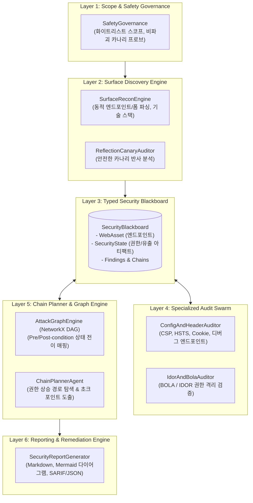

# WVA (Web Vulnerability Auditor)
> **차세대 지능형 웹 취약점 연계 분석 및 공격 경로 시뮬레이션 Agent**

[](https://www.python.org/)
[](LICENSE)
[](#시스템-아키텍처)

---

## 📌 프로젝트 개요 (Overview)

현대의 공격 에이전트 및 고도화된 침투 공격은 단일한 고위험 취약점을 직접 공략하기보다, **사소해 보이는 여러 개의 저·중위험(Low/Medium) 취약점을 수집·결합(Chaining)하여 최고 권한(Admin/System)을 장악하는 다단계 공격 경로(Attack Path)**를 활용합니다.

**WVA (Web Vulnerability Auditor)**는 이러한 공격 기법을 역으로 추적·시뮬레이션하여:
1. **복합 공격 경로(Exploit Chain)**를 정형 상태 전이 그래프(DAG) 기반으로 사전 탐지하고,
2. 방어자가 최소 비용으로 전체 공격을 원천 차단할 수 있는 **최적 차단 거점(Choke Point)**을 도출하는 지능형 보안 감사 에이전트 시스템입니다.

---

## 🏛️ 시스템 아키텍처 (Architecture)



### 핵심 차별화 요소
- **State-based Attack Path Graph**: 단순 텍스트 추론 대신 NetworkX 유향 그래프(DAG) 기반으로 전제조건(Preconditions)과 후조건(Postconditions)의 상태 변화를 정형화.
- **Typed Security Blackboard**: Pydantic 기반의 강타입 데이터 모델을 통해 에이전트 간 정보 전달 시 토큰 낭비 및 환각(Hallucination) 방지.
- **Choke Point Defense**: 공격 체인을 끊어내기 위한 최소 비용 최우선 패치 거점 자동 산출.

---

## 🚀 빠른 시작 (Quick Start)

### 1. 환경 설정 및 의존성 설치
```bash
# 가상환경 생성 및 활성화
python -m venv .venv
source .venv/bin/activate  # Windows: .venv\Scripts\activate

# 의존성 패키지 설치
pip install -r requirements.txt
```

### 2. Windows 원클릭 실행 (배치 파일)
* `1_WVA_웹취약점_연계분석_데모실행.bat` (영문: `START_WVA_CHAIN_AUDITOR_DEMO.bat`): 자체 모의 서버 구동 및 3단계 연계 취약점 데모 분석 실행
* `2_WVA_취약점분석_CLI_직접실행.bat` (영문: `RUN_WVA_SCANNER_CLI.bat`): 대화형 CLI 메뉴를 통한 타깃 URL 직접 분석

### 3. CLI 명령어 실행
```bash
# 모의 타깃 자동 연계 데모 실행
python cli.py --demo

# 사용자 지정 웹 애플리케이션 진단
python cli.py --target http://localhost:8080
```

---

## 📂 프로젝트 구조 (Directory Structure)

```text
WVA/
├── 1_WVA_웹취약점_연계분석_데모실행.bat     # 모의 취약점 타깃 자동 구동 및 연계 분석 데모
├── START_WVA_CHAIN_AUDITOR_DEMO.bat     # 영문 동등 실행 파일
├── 2_WVA_취약점분석_CLI_직접실행.bat       # 대화형 CLI 메뉴
├── RUN_WVA_SCANNER_CLI.bat              # 영문 동등 실행 파일
│
├── WVA_설계계획서_최종본.md               # 시스템 최종 설계 계획서
├── WVA_취약점분석_결과보고서_초안.md      # 취약점 연계 분석 결과보고서 초안
├── WVA_사용설명서.txt                     # 사용자 매뉴얼
│
├── cli.py                               # CLI 진입점 및 데모 오케스트레이터
├── mock_target.py                       # 연계 취약점 검증용 모의 테스트베드 앱 (FastAPI)
├── requirements.txt                     # 의존성 패키지 목록
│
├── core/
│   ├── models/                          # Asset, SecurityState, Vulnerability, ExploitChain 모델
│   ├── graph/                           # AttackGraphEngine (NetworkX DAG), SecurityBlackboard
│   └── safety/                          # SafetyGovernance (화이트리스트 스코프, 비파괴 정책)
│
├── surface/                             # SurfaceReconEngine (자산/엔드포인트), ReflectionCanaryAuditor
├── agents/                              # ConfigAuditor, IdorAuditor, ChainPlanner, AnalysisEngine
└── reporting/                           # Markdown (Mermaid 포함) 및 JSON 리포트 생성기
```

---

## 🛡️ 안전성 및 보안 윤리 (Safety & Disclaimer)

* 본 도구는 **사전 인가된 환경에서의 정당한 보안 감사 및 방어 목적**으로 설계되었습니다.
* `SafetyGovernance` 모듈을 통해 파괴적 행위(`DROP`, `DELETE` 등) 및 스코프 외부 도메인에 대한 접근을 원천 차단합니다.
* 승인되지 않은 외부 시스템에 대한 무단 진단 및 악의적 사용은 법률에 의해 엄격히 금지됩니다.
