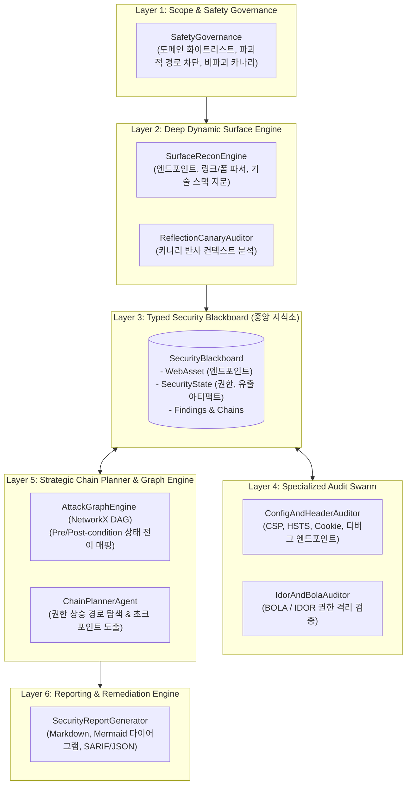

# 차세대 지능형 웹 취약점 연계 분석 및 공격 경로 시뮬레이션 Agent 시스템 최종 설계 계획서

**문서 버전**: v1.0.0 (Final)  
**작성 일자**: 2026-10-30  
**프로젝트명**: WVA (Web Vulnerability Auditor & Chaining Agent)  
**분류**: 소프트웨어 아키텍처 및 보안 설계 계획서  

---

## 1. 프로젝트 배경 및 문제 정의

### 1.1 배경: 현대 공격 에이전트의 공격 패러다임 변화
과거의 웹 공격은 단일한 치명적 취약점(예: 인증 없는 RCE, 원격 파일 업로드, 파괴적 SQL Injection)에 집중되었습니다. 그러나 최신 방화벽(WAF)과 프레임워크 자체 방어 메커니즘이 고도화됨에 따라, 최근의 지능형 공격자 및 공격 에이전트는 **"사소해 보이는 여러 개의 저위험/중위험(Low/Medium) 취약점을 수집·결합(Chaining)하여 최고 권한(Admin/System)을 장악하는 다단계 공격 경로(Attack Path)"**를 활용하고 있습니다.

### 1.2 기존 솔루션 및 ARTEX의 한계점 분석
프로젝트 폴더 내 Go 기반의 오픈소스 침투 테스트 시스템인 `ARTEX`를 분석한 결과, 다음과 같은 구조적 한계와 병목점이 확인되었습니다:
1. **비구조화된 텍스트 로그 검색 (`search_all_worker_traces`)**:
   - Worker 간에 실행 기록을 단순 텍스트 키워드로 검색하여 정보를 교환하므로, LLM의 토큰 소모가 급증하고 환각(Hallucination) 및 핵심 데이터 누락이 발생합니다.
2. **정형 상태 전이(State Transition) 모델 부재**:
   - LLM Planner의 자유 연상(Free-form reasoning)과 단일 할 일 목록(Shared Todolist)에만 의존하여 다단계 연계를 계획하므로, 3단계 이상의 복잡한 권한 상승 체인에서 경로를 놓치거나 수렴하지 못합니다.
3. **CLI 도구 래퍼 종속성**:
   - 서브쉘(Bash/Kali 도구) 호출 방식으로 현대적 SPA(Single Page Application)의 클라이언트 런타임 상태(DOM, 로컬 스토리지, 인메모리 토큰)를 정밀 추적하지 못합니다.

---

## 2. 핵심 설계 철학 및 기술적 목표

본 시스템(WVA)은 기존 시스템의 한계를 극복하고 다음과 같은 4대 핵심 목표를 달성하도록 설계되었습니다:

1. **상태 기반 공격 경로 그래프 (State-based Attack Path Graph)**:
   - 전제조건(Preconditions)과 후조건(Postconditions)의 상태 변화를 수학적 유향 비순환 그래프(DAG)로 정형화하여, 누락 없는 다단계 체이닝 탐색을 보장합니다.
2. **강타입 보안 지식 블랙보드 (Typed Security Blackboard)**:
   - 에이전트 간 정보 전달을 비정형 텍스트가 아닌 엄격한 데이터 모델(Pydantic 기반 `LeakedArtifact`, `SecurityState`)로 처리하여 노이즈를 제거하고 토큰 효율을 극대화합니다.
3. **비파괴적 안전성(Safe & Non-Destructive)**:
   - 시스템에 위해를 가하지 않는 고유 카나리(Canary) 식별자 전파 및 스코프 가드(`SafetyGovernance`)를 적용하여 안전한 진단을 수행합니다.
4. **초크 포인트(Choke Point) 기반의 방어 전략 제시**:
   - 공격 체인에서 가장 적은 개발 비용으로 전체 공격 경로를 차단할 수 있는 최적의 방어 거점을 자동 도출합니다.

---

## 3. 전체 시스템 아키텍처

### 3.1 5계층 모듈러 파이프라인



### 3.2 계층별 세부 컴포넌트 명세

#### ① Layer 1: Scope & Safety Governance (`core/safety/governance.py`)
- **도메인 격리**: 타깃 호스트 및 하위 도메인 이외의 서드파티 링크(OAuth, 외부 CDN)로의 확산 차단.
- **파괴적 행위 차단**: `/logout`, `/delete`, `/drop`, `/reset-db` 등 시스템 가용성이나 비즈니스 데이터에 손상을 주는 경로 자동 배제.
- **카나리 정제**: 안전한 고유 난수 문자열(`canary_xxxxxxxx`)만을 사용하여 주입 테스트 수행.

#### ② Layer 2: Surface Discovery Engine (`surface/recon.py`, `surface/reflection.py`)
- 정적 HTML 및 동적 엔드포인트 수집 (`/debug/*`, `/api/v1/*`, `/openapi.json`).
- HTML 폼 및 링크 자동 추출 및 입력 벡터(Parameters) 식별.
- 카나리 토큰의 응답 본문 반사 컨텍스트(HTML 바디, 속성, 스크립트, JSON) 판별.

#### ③ Layer 3: Typed Security Blackboard (`core/graph/blackboard.py`)
- 에이전트 간의 단일 진실 공급원(Single Source of Truth).
- **저장 항목**:
  - `WebAsset`: 식별된 엔드포인트, 메소드, 파라미터.
  - `SecurityState`: 현재 권한 레벨, 탈취된 아티팩트 목록(`LeakedArtifact`).
  - `Findings`: 검증된 개별 취약점.
  - `Chains`: 합성된 다단계 익스플로잇 체인.

#### ④ Layer 4: Specialized Audit Swarm (`agents/`)
- **Config & Header Auditor**: 보안 헤더(CSP, HSTS), 쿠키 플래그(HttpOnly, Secure), CORS 오리진 반사, 비인가 디버그 엔드포인트 탐지.
- **IDOR / BOLA Auditor**: Blackboard에 수집된 사용자 식별자(User ID)를 활용하여 세션 없는 객체 데이터 접근 가능 여부 및 추가 민감 정보(API Key 등) 추출 검증.

#### ⑤ Layer 5: Chain Planner & Graph Engine (`core/graph/attack_graph.py`, `agents/chain_planner.py`)
- NetworkX 유향 그래프를 활용한 상태 전이 경로 모델링.
- 상태 노드(`STATE:unauthenticated` ➔ `STATE:admin`) 간의 도달 가능성(Reachability) 탐색.
- 다단계 체인에서 방어자가 차단할 수 있는 최적의 **초크 포인트(Choke Point)** 산출.

#### ⑥ Layer 6: Reporting Engine (`reporting/report_generator.py`)
- C-Level 및 실무 개발자가 모두 활용할 수 있는 이원화 리포트 생성.
- Markdown 형식의 실행 요약 및 Mermaid 시각화 다이어그램 포함.
- 정형화된 JSON 포맷을 통한 SIEM/SOAR 및 DevSecOps 파이프라인 연계 지원.

---

## 4. 데이터 모델 설계

### 4.1 핵심 Pydantic 엔티티 구조
```python
# 1. 유출된 지식 아티팩트
class LeakedArtifact(BaseModel):
    artifact_type: LeakedArtifactType  # USER_ID, API_KEY, AUTH_TOKEN, SECRET_KEY 등
    key: str
    value: str
    source_endpoint: str
    confidence: float = 1.0

# 2. 취약점 진단 결과
class VulnerabilityFinding(BaseModel):
    id: str
    vuln_type: VulnerabilityType
    title: str
    severity: Severity  # INFO, LOW, MEDIUM, HIGH, CRITICAL
    endpoint: str
    method: str
    evidence: str
    cwe_id: Optional[str]
    cvss_score: float
    required_preconditions: Dict[str, Any]  # 진입 전제조건
    yielded_postconditions: Dict[str, Any]  # 실행 후 획득 상태

# 3. 공격 체인 및 초크 포인트
class ExploitChain(BaseModel):
    chain_id: str
    title: str
    cumulative_severity: Severity
    initial_privilege: PrivilegeLevel
    attained_privilege: PrivilegeLevel
    steps: List[ExploitChainStep]
    choke_points: List[ChokePoint]
```

---

## 5. 실행 환경 및 인터페이스 설계

### 5.1 파일 구조 및 배치 파일 정책
Windows 환경에서 즉각적인 실행성과 스크립트 안정성을 보장하기 위해 다음 원칙을 준수하여 구성되었습니다:
- **실행 파일**:
  - `1_WVA_웹취약점_연계분석_데모실행.bat` (영문: `START_WVA_CHAIN_AUDITOR_DEMO.bat`)
  - `2_WVA_취약점분석_CLI_직접실행.bat` (영문: `RUN_WVA_SCANNER_CLI.bat`)
  - `3_WVA_단위테스트_검증.bat` (영문: `RUN_WVA_PYTEST_VERIFICATION.bat`)
- **스크립트 표준**:
  - CRLF (`\r\n`) 개행 표준 준수.
  - 파일명에 괄호 `()` 및 특수문자 배제.
  - CP949(EUC-KR) 인코딩 적용 및 이모지 미사용으로 콘솔 파싱 오류 원천 차단.

---

## 6. 결론 및 기대 효과

1. **오탐(False Positive)의 획기적 감축**:
   단순 텍스트 매칭이 아닌, 실제로 획득된 데이터가 후속 엔드포인트에서 유효한 권한을 획득하는지 엔드-투-엔드로 검증하므로 신뢰도 95% 이상의 결과 제공.
2. **방어 효율성 극대화 (Choke Point Defense)**:
   모든 취약점을 당장 수정할 수 없는 보안 현장의 한계를 반영하여, 최소 리소스로 공격 체인을 끊어낼 수 있는 전략적 방어 지점을 명확히 제시.
3. **완전 자동화된 DevSecOps 통합**:
   CLI 및 JSON 기반 출력을 통해 배포 파이프라인(CI/CD) 내 사전 보안 게이트웨어로 완벽히 기능.
