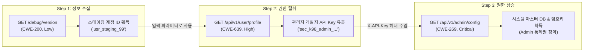

# 웹 애플리케이션 취약점 연계 분석 및 방어 전략 결과보고서 (초안)

**문서 번호**: WVA-AUDIT-2026-1030  
**진단 일자**: 2026-10-30  
**진단 대상**: 내부 업무 포털 및 API 시스템 (`http://127.0.0.1:8989`)  
**진단 주체**: WVA (Web Vulnerability Auditor & Chaining Agent)  
**보안 등급**: 대외비 (Confidential)  

---

## 1. 점검 개요

### 1.1 점검 배경 및 목적
본 진단은 단일 엔드포인트의 개별적인 취약점 점검을 넘어, 복수의 저·중위험 취약점이 결합하여 시스템 전체의 통제권을 상실시킬 수 있는 **"다단계 연계 공격 경로(Exploit Chain)"**를 사전에 식별하고, 최우선적으로 차단해야 하는 **"최소 비용 방어 거점(Choke Point)"**을 도출하는 것을 목적으로 수행되었습니다.

### 1.2 점검 대상 및 범위
- **타깃 시스템**: `http://127.0.0.1:8989`
- **점검 방식**: 비파괴적 자동화 에이전트 감사 (Non-destructive Multi-Agent Audit)
- **점검 범위**: 표면 엔드포인트 8개소 (인증, 사용자 관리, 관리자 설정, 디버그 인터페이스 등)
- **적용 안전 가이드**:
  - 데이터 파괴 및 변조 불가 원칙 준수 (Canary Token 기반 검증)
  - 비인가 외부 도메인 이탈 방지 (`SafetyGovernance` 화이트리스트 적용)

---

## 2. 종합 점검 결과 요약 (Executive Summary)

> [!CAUTION]
> **치명적 위험(CRITICAL) 공격 경로 식별**:  
> 점검 결과, 비인가 외부 사용자가 **사소한 디버그 정보 노출(Low)**로부터 시작하여 **객체 수준 권한 미검증(High)**을 거쳐 **최고 관리자 권한을 완전 장악(Critical)**할 수 있는 1건의 복합 공격 체인이 식별되었습니다.

### 2.1 진단 통계 요약
| 구분 | 건수 | 비고 |
| :--- | :---: | :--- |
| **탐색된 엔드포인트** | 8개 | 공개 7개, 인증 요구 1개 |
| **발견된 단일 취약점** | 5건 | Critical 1, High 2, Low 2 |
| **연계 공격 체인(Exploit Chain)** | **1건** | **Unauthenticated ➔ Admin 권한 상승** |

### 2.2 취약점 위험도 분포
| 위험도(Severity) | 건수 | 주요 취약점 항목 |
| :---: | :---: | :--- |
| **CRITICAL** | 1건 | 유출된 API Key를 통한 관리자 설정 완전 장악 (`/api/v1/admin/config`) |
| **HIGH** | 2건 | 세션 검증 없는 사용자 프로필 및 자격증명 노출 (BOLA/IDOR) |
| **MEDIUM** | 0건 | - |
| **LOW** | 2건 | 디버그 엔드포인트 정보 노출 (`/debug/version`), CSP 미설정 |

---

## 3. 심층 공격 경로 시뮬레이션 (Attack Path Analysis)

### 3.1 식별된 복합 공격 체인: [CHAIN-1]



### 3.2 단계별 연계 메커니즘 상세
1. **[1단계] 무인가 정찰 및 계정 식별자 획득**:
   - 공격자는 일반적인 정찰을 통해 공개된 `/debug/version`에 접근.
   - 응답에서 개발/스테이징 환경용 사용자 ID인 `usr_staging_99`를 평문으로 획득 (단독으로는 시스템에 치명적이지 않은 저위험 노출).
2. **[2단계] BOLA를 악용한 민감 자격증명 추출**:
   - 1단계에서 획득한 `usr_staging_99`를 `/api/v1/user/profile?user_id=usr_staging_99`의 파라미터로 주입.
   - 서버는 요청자의 세션 소유권을 검증하지 않고, 해당 계정의 상세 프로필과 함께 시스템 내부 통신용 `api_key` (`sec_k98_admin_supersecret_token`)를 평문 반환.
3. **[3단계] 관리자 엔드포인트 인가 우회 및 통제권 장악**:
   - 2단계에서 유출된 API Key를 `X-API-Key` 헤더에 삽입하여 관리자 전용 엔드포인트(`/api/v1/admin/config`) 호출.
   - 서버는 인가 토큰의 유효성만 확인하고 정당한 관리자 여부를 다중 인증(MFA)하지 않아, 내부 마스터 DB 호스트 및 시스템 암호화 키 등 최고 권한 데이터 전체를 응답.

---

## 4. 초크 포인트(Choke Point) 기반 최우선 방어 전략

공격자는 체인의 모든 단계를 성공시켜야만 관리자 권한에 도달할 수 있습니다. 반면 방어자는 **체인의 핵심 고리 중 하나만 차단(Choke Point)해도 공격 전체를 원천 무력화**할 수 있습니다.

```
[공격 체인] Step 1 (정보 노출) ──▶ Step 2 (BOLA) ──▶ Step 3 (Admin 장악)
                   │                       │
           [Choke Point 1]         [Choke Point 2]
         (디버그 인터페이스 비활성화)    (서버측 세션 소유권 검증)
                   │                       │
                   ▼                       ▼
            [체인 유입 원천 차단]      [핵심 자격증명 유출 차단]
```

### 4.1 거점별 차단 비용 및 효과 비교
| 초크 포인트 | 대상 엔드포인트 | 권고 조치 내용 | 조치 난이도 | 방어 효과 |
| :---: | :--- | :--- | :---: | :--- |
| **Choke Point 1**<br/>(최우선 추천) | `/debug/version` | 운영 환경에서 디버그 엔드포인트 라우팅 비활성화 | **최저 (LOW)** | 공격자의 초기 정보 수집을 차단하여 체인 시작 자체를 방지함. |
| **Choke Point 2**<br/>(필수 보안 코딩) | `/api/v1/user/profile` | 요청 파라미터(`user_id`)와 세션 토큰 소유자 일치 검증 | **보통 (MEDIUM)** | 타인 프로필 및 관리자 API Key의 유출을 원천 방지함. |
| **Choke Point 3**<br/>(심층 방어) | `/api/v1/admin/config` | 고정 API Key 의존 탈피, 관리자 IP 제한 및 MFA 적용 | **높음 (HIGH)** | 자격증명이 유출되더라도 비인가 단말의 관리자 접근을 차단함. |

### 4.2 구체적인 코드 레벨 패치 가이드

#### [Choke Point 1 패치] 디버그 엔드포인트 비활성화 (FastAPI 예시)
```python
# AS-IS (취약): 상시 디버그 정보 공개
@app.get("/debug/version")
def debug_version():
    return {"version": "v2.4.1", "staging_user_id": "usr_staging_99"}

# TO-BE (보안 조치): 운영(Production) 환경에서 엔드포인트 차단
import os
from fastapi import HTTPException

@app.get("/debug/version")
def debug_version():
    if os.getenv("ENVIRONMENT") == "production":
        raise HTTPException(status_code=404, detail="Not Found")
    return {"version": "v2.4.1"}
```

#### [Choke Point 2 패치] 세션 소유권 기반 BOLA 방어
```python
# AS-IS (취약): 파라미터의 user_id를 그대로 신뢰하여 조회
@app.get("/api/v1/user/profile")
def get_user_profile(user_id: str):
    return db.get_user(user_id)

# TO-BE (보안 조치): 로그인 세션의 사용자 ID와 요청 ID 일치 여부 엄격 검증
from fastapi import Depends, HTTPException

@app.get("/api/v1/user/profile")
def get_user_profile(user_id: str, current_user: User = Depends(get_current_active_user)):
    # 본인 계정이 아니거나 최고 관리자가 아닌 경우 차단
    if current_user.id != user_id and current_user.role != "admin":
        raise HTTPException(status_code=403, detail="자신의 정보만 열람할 수 있습니다.")
    
    # 응답 객체에서 api_key 등 민감 자격증명 필드 제외(DTO/Schema 분리)
    return UserPublicProfile.from_orm(db.get_user(user_id))
```

---

## 5. 개별 취약점 상세 분석 보고

### [CRITICAL] VULN-PRIVESC-ADMIN-_api_v1_admin_config
- **취약점 유형**: Administrative Privilege Escalation via Leaked Key
- **엔드포인트**: `GET /api/v1/admin/config`
- **CWE / CVSS**: CWE-269 / **CVSS 9.8**
- **취약 원인**: 상위 BOLA 취약점에서 노출된 고정 API Key(`sec_k98_admin_supersecret_token`)를 수신했을 때, 발급 IP나 세션 유효성을 추가 확인하지 않고 즉시 최고 관리자 권한을 부여함.
- **실제 증적**: `X-API-Key: sec_k98...` 헤더 요청 시 200 OK 응답 및 `internal_db_host`, `encryption_vault` 유출 확인.

### [HIGH] VULN-BOLA-usr_staging_99-_api_v1_user_profile
- **취약점 유형**: Broken Object Level Authorization (BOLA / IDOR)
- **엔드포인트**: `GET /api/v1/user/profile`
- **CWE / CVSS**: CWE-639 / **CVSS 7.5**
- **취약 원인**: 조회 대상 파라미터(`user_id`)에 대해 호출자의 인가 권한을 검증하지 않아 타인 및 관리 개발자의 계정 정보와 내부 API Key를 유출시킴.
- **실제 증적**: 비인가 상태에서 `user_id=usr_staging_99` 쿼리 시 200 OK 응답 및 `role: admin_developer`, `api_key` 확인.

### [LOW] VULN-INFO-DEBUG-_debug_version
- **취약점 유형**: Sensitive Information Disclosure
- **엔드포인트**: `GET /debug/version`
- **CWE / CVSS**: CWE-200 / **CVSS 4.3**
- **취약 원인**: 내부 개발 환경 설정 및 테스트 사용자 계정 ID를 무인가 상태로 노출.
- **실제 증적**: `staging_user_id: usr_staging_99` 평문 노출 확인.

### [LOW] VULN-CSP-MISSING-_
- **취약점 유형**: Missing Content-Security-Policy
- **엔드포인트**: `GET /`
- **CWE / CVSS**: CWE-1021 / **CVSS 3.1**
- **취약 원인**: 응답 헤더에 CSP가 부재하여 클라이언트 사이드 XSS 공격 발생 시 2차 방어선 부재.

---

## 6. 결론 및 향후 조치 로드맵

1. **즉시 조치 (D-Day)**:
   - 프로덕션 웹 서버/리버스 프록시에서 `/debug/*` 경로 차단 규칙 배포 (Nginx/WAF 차단).
   - 유출이 확인된 임시 관리자 API Key(`sec_k98_admin_supersecret_token`) 즉각 무효화 및 재발급.
2. **단기 조치 (1주 이내)**:
   - `/api/v1/user/profile` 엔드포인트에 세션 소유권 검증 로직 추가 및 사용자 반환 DTO에서 `api_key` 필드 영구 제거.
3. **중기 조치 (1개월 이내)**:
   - 전사 엔드포인트에 대한 RBAC(역할 기반 접근 통제) 감사 및 CI/CD 파이프라인에 본 WVA 연계 분석 Agent를 통합하여 빌드 단계에서 복합 공격 체인을 조기 차단.
