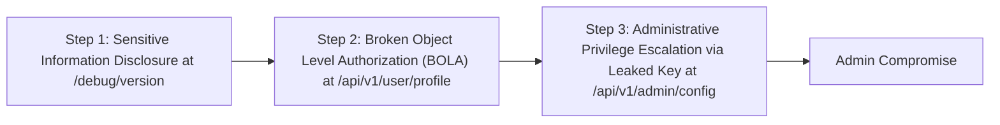

# Web Vulnerability & Attack Path Chaining Analysis Report

- **Target URL**: `http://127.0.0.1:8989`
- **Discovered Endpoints**: 8
- **Total Individual Findings**: 5
- **Identified Exploit Chains**: 1

## 1. Executive Summary (Vulnerability Chaining Analysis)
> [!CAUTION]
> **CRITICAL ATTACK PATH DETECTED**: Multiple low/medium vulnerabilities can be chained by an attacker to achieve full administrative compromise.

### Multi-step Chained Escalation: Exploit Sensitive Information Disclosure at /debug/version at /debug/version -> Exploit Administrative Privilege Escalation via Leaked Key at /api/v1/admin/config at /api/v1/admin/config
- **Severity**: **CRITICAL**
- **Privilege Escalation**: `unauthenticated` ➔ `admin`
- **Impact**: Chaining 3 individual findings escalates from Unauthenticated to Admin privilege access.

#### 🛡️ Choke Point Defensive Strategy (최소 비용 최우선 방어 거점)
공격자는 체인 전체를 성공시켜야 하지만, 방어자는 다음 핵심 차단점 중 하나만 해결해도 공격 경로 전체를 무력화할 수 있습니다:

- **[Step 1 차단] /debug/version** (수정 난이도: LOW)
  - 조치: `Disable debug endpoints in production environments and restrict access via authentication middleware.`
  - 효과: Fixing Step 1 prevents progression to critical impact

- **[Step 2 차단] /api/v1/user/profile** (수정 난이도: MEDIUM)
  - 조치: `Implement server-side session-to-object ownership validation on every data access query.`
  - 효과: Fixing Step 2 prevents progression to critical impact

- **[Step 3 차단] /api/v1/admin/config** (수정 난이도: MEDIUM)
  - 조치: `Implement strict role-based access control (RBAC), rotate leaked keys, and enforce MFA for admin endpoints.`
  - 효과: Fixing Step 3 prevents progression to critical impact

## 2. Individual Vulnerability Findings

| ID | Severity | Title | Endpoint | CWE |
|:---|:---:|:---|:---|:---:|
| VULN-CSP-MISSING-_ | LOW | Missing Content-Security-Policy (CSP) | `/` | CWE-1021 |
| VULN-INFO-DEBUG-_debug_version | LOW | Sensitive Information Disclosure at /debug/version | `/debug/version` | CWE-200 |
| VULN-BOLA-usr_staging_99-_api_v1_user_profile | HIGH | Broken Object Level Authorization (BOLA) at /api/v1/user/profile | `/api/v1/user/profile` | CWE-639 |
| VULN-BOLA-usr_staging_99-_api_v1_user_export | HIGH | Broken Object Level Authorization (BOLA) at /api/v1/user/export | `/api/v1/user/export` | CWE-639 |
| VULN-PRIVESC-ADMIN-_api_v1_admin_config | CRITICAL | Administrative Privilege Escalation via Leaked Key at /api/v1/admin/config | `/api/v1/admin/config` | CWE-269 |

### [LOW] Missing Content-Security-Policy (CSP)
- **Endpoint**: `GET /`
- **CVSS Score**: 3.1
- **Description**: The server does not enforce a Content-Security-Policy header, reducing defense-in-depth against XSS and content injection.
- **Evidence**: `HTTP Response Headers did not contain 'content-security-policy'`
- **Remediation**: Define and enforce a strict CSP (e.g. default-src 'self').

### [LOW] Sensitive Information Disclosure at /debug/version
- **Endpoint**: `GET /debug/version`
- **CVSS Score**: 4.3
- **Description**: Debug endpoint exposes internal identifiers and system metadata without authentication.
- **Evidence**: `Disclosed metadata: staging_user_id: usr_staging_99`
- **Remediation**: Disable debug endpoints in production environments and restrict access via authentication middleware.

### [HIGH] Broken Object Level Authorization (BOLA) at /api/v1/user/profile
- **Endpoint**: `GET /api/v1/user/profile`
- **CVSS Score**: 7.5
- **Description**: Unauthenticated request with user_id=usr_staging_99 retrieved full user profile data and credentials.
- **Evidence**: `Endpoint returned 200 OK for user_id=usr_staging_99 without session auth. Role: admin_developer`
- **Remediation**: Implement server-side session-to-object ownership validation on every data access query.

### [HIGH] Broken Object Level Authorization (BOLA) at /api/v1/user/export
- **Endpoint**: `GET /api/v1/user/export`
- **CVSS Score**: 7.5
- **Description**: Unauthenticated request with user_id=usr_staging_99 retrieved full user profile data and credentials.
- **Evidence**: `Endpoint returned 200 OK for user_id=usr_staging_99 without session auth. Role: None`
- **Remediation**: Implement server-side session-to-object ownership validation on every data access query.

### [CRITICAL] Administrative Privilege Escalation via Leaked Key at /api/v1/admin/config
- **Endpoint**: `GET /api/v1/admin/config`
- **CVSS Score**: 9.8
- **Description**: Using an API key leaked via upstream BOLA vulnerability grants unauthenticated attackers full administrative control.
- **Evidence**: `Harvested API Key 'sec_k9...' successfully unlocked /api/v1/admin/config. Admin status: 200 OK`
- **Remediation**: Implement strict role-based access control (RBAC), rotate leaked keys, and enforce MFA for admin endpoints.

## 3. Discovered Attack Surface Endpoints

- `GET /` (Public) [Source: surface_discovery]
- `GET /search` (Public) [Source: form_parser]
- `GET /api/v1/user/profile` (Public) [Source: link_parser]
- `GET /docs` (Public) [Source: surface_discovery]
- `GET /openapi.json` (Public) [Source: surface_discovery]
- `GET /debug/version` (Public) [Source: surface_discovery]
- `GET /api/v1/user/export` (Public) [Source: surface_discovery]
- `GET /api/v1/admin/config` (Auth Required) [Source: surface_discovery]

