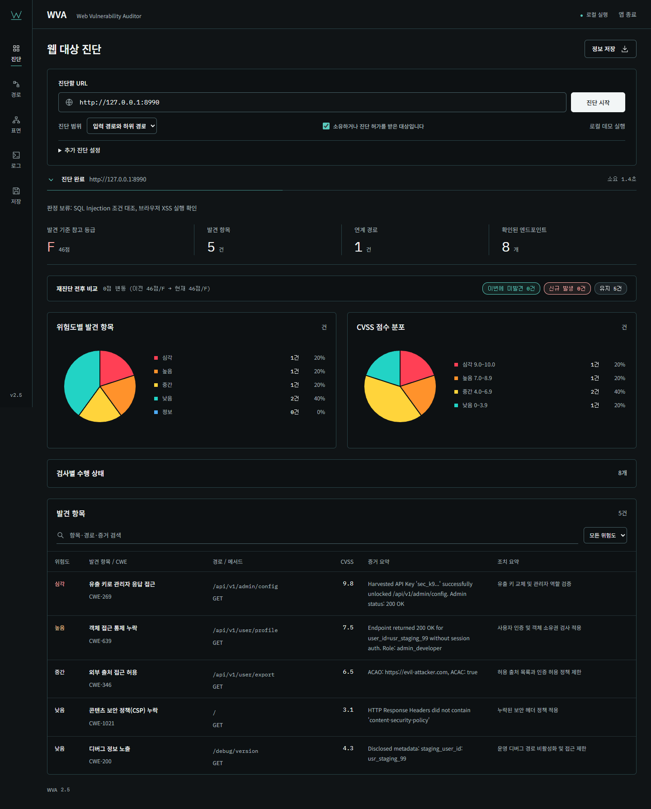
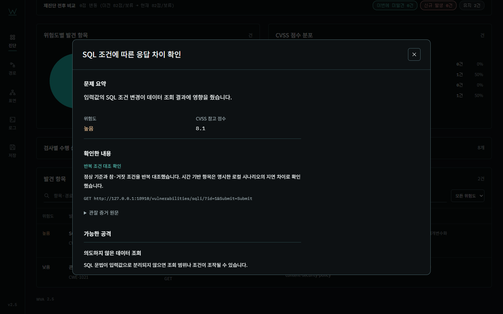

# WVA 2.5 보완 구현·재빌드 검증 보고서

작성일: 2026-11-04 · 최종 실행파일: WVA.exe / 2.5.0

## 문제와 변경 결과

2.4는 SQL Injection·XSS 설계 문서와 별도 반사 도우미가 있었지만, 기본 엔진에서 실제 SQLi/XSS를 검사하지 않았다. 독립 설치한 DVWA·Juice Shop의 양성 4개를 소스·실행파일 모두 놓쳤고 97점/A를 표시했다. [이전 실측](../tests/benchmarks/BASELINE_2.4.md)은 당시 기록으로 보존한다.

2.5는 SQL 조건 반복 대조와 브라우저 실행 표식 확인을 실제 진단 경로에 연결했다. 같은 양성 4개와 방어 대조 2개를 소스·실행파일에서 구분했다. 세션·CSRF·JavaScript 라우트, 계정·역할 대조와 저장형/시간 기반 로컬 시나리오도 구현했다. 전체 OWASP 항목이나 설계 문서 R01~R13의 모든 세부 기능을 구현했다고 표현하지 않는다.

## 보완사항별 구현

| 이전 문제 | 최종 구현 | 실제 확인 |
| --- | --- | --- |
| SQLi 실행 규칙 부재 | 안정 기준 2회, 숫자/따옴표/검색 문맥 조건 쌍 2회, WAF·오류·불안정 구분 | DVWA·Juice Shop 양성, DVWA impossible 및 SQLite 정상 대조 |
| XSS 실행 규칙 부재 | 반사·DOM 후보, 격리 브라우저의 고유 표식 실행, CSP·인코딩 대조 | 제3자 앱 2개와 자체 반사/DOM/CSP 사례 |
| HTTP·브라우저 경계 분리 | 공통 요청 수·응답 크기·출처·경로·메서드 제한, WS·Service Worker·다운로드 차단, Chromium sandbox 활성화 | 외부 sink 0회, 다른 경로/POST/WS 차단, 실제 스트림/횟수 제한 |
| 쿠키·CSRF·로그인 부족 | 같은 쿠키 저장소에서 숨겨진 CSRF 갱신, 명시한 폼 로그인, 기준 세션 선택 | 실제 로그인 POST와 보호 응답, 부가/중복 쿼리 보존 |
| 계정·역할 구분 부족 | 소유자/관리자 안정 기준과 거부 계정·미인증의 보호 필드 대조 | 양성·거부 정책, source/exe 일치 |
| 저장형·시간 SQL 미검증 | 명시한 로컬 프로필의 저장/별도 읽기/정리와 제한된 3쌍 시간 대조 | 실제 SQLite 조건 지연, 실행 표식, 정리·취소 정리 |
| 미실행이 높은 등급으로 표시 | 검사별 상태/사유, SQLi/XSS 미완료 또는 어느 검사든 오류가 있으면 A~D 보류 | API·UI·재진단 비교, 계정 오류/보류 대조 |
| 발견과 일부 실패 혼동 | 발견이 있어도 errors 수와 일부 미완료를 기록 | UI·JSON·Markdown·CSV의 동일 검사 정보 |
| 세션 비밀과 이력 비교 | 비밀 값 공개 출력 가림, 검증 오류 입력값 제거, 같은 가림 프로필끼리 비교 | 인증정보 비노출, 세션 포함 실제 반복 진단 |
| 완료 시점과 표 데이터 불일치 | 결과 표를 갱신한 뒤 완료 상태 표시, 진행 중 발견/경로 버튼 잠금 | 브라우저 전체 흐름 40건 |
| 실행파일/화면 버전 불일치 | 드라이버 포함 재빌드, API·레일·하단 버전 2.5 정합 | 독립 실행과 실제 브라우저 |

새 SQLi·XSS·정책 대조 항목은 문제 요약·관찰 사실·가능한 공격의 조건·판정 범위·순서별 조치·수정 후 확인을 제공한다. 원문과 AI 프롬프트는 접힌 영역에 둔다. 기본 진단은 GET/HEAD이며 프로필에 명시한 로그인과 로컬 저장·정리 URL만 POST를 허용한다. 보고서의 검사 범위 설명도 이 예외를 명시한다.

## 최종 검증 결과

| 범위 | 실제 결과 | 근거 |
| --- | --- | --- |
| 전체 기능 회귀 | **123/123 PASS** | tests/artifacts/pytest.xml, pytest-output.txt |
| 소스 없는 한글 경로 exe | **27/27 PASS** | executable-smoke.json |
| 실제 화면 작업 흐름 | **40/40 PASS**, JS 예외·외부 자산 요청 0건 | browser/result.json 및 화면 PNG |
| 독립 취약점·방어 기준 | **6/6 PASS** | benchmark/result.json, browser-ground-truth.json, SQL 응답 HTML |
| 제3자 앱 소스/exe 대조 | **12/12 일치** | 양성 4개·방어 대조 2개를 각각 실행 |
| 계정·역할·시간·저장형 source/exe | **10/10 PASS** | benchmark/extended-result.json |
| 화면 보조 검사 | 1440/768/390px 가로 넘침 0, JS 예외 0, 0 FAIL / 2 WARN | visual-final/report.json |

서로 다른 검증 범위의 수를 합쳐 탐지 정확도로 표시하지 않는다. 이 소규모 정답 표본의 탐지 결과를 모든 사이트의 성능으로 일반화하지 않는다. 검사 자체가 기대한 ERROR·SIGNAL·NOT_RUN을 올바르게 반환한 테스트도 기능 회귀 PASS에 포함되며 해당 실제 상태는 보고서와 화면에서 유지한다.

## 제3자 앱 결과

| 대상 | 독립 확인 | 2.5 소스 | 2.5 exe |
| --- | --- | --- | --- |
| DVWA low SQL | 참/기준 1행, 거짓 0행, 2회 반복 | SQLi 발견 | SQLi 발견 |
| DVWA impossible SQL | 정상만 1행, 조건 문자열 거부 | 관련 발견 없음 | 관련 발견 없음 |
| DVWA low 반사 XSS | 고유 표식 실행 | XSS 발견 | XSS 발견 |
| DVWA impossible 반사 XSS | 안전한 텍스트, 표식 없음 | 관련 발견 없음 | 관련 발견 없음 |
| Juice Shop 검색 SQL | 기준/참 상품 ID 일치, 거짓 없음 | SQLi 발견 | SQLi 발견 |
| Juice Shop DOM XSS | 브라우저 문서 표식 실행 | XSS 발견 | XSS 발견 |

CSP 누락을 SQLi/XSS 발견으로 집계하지 않았다. JSON만 반환하는 API의 CSP 누락 오탐도 제외했다. 루트 주소에서 렌더링된 검색 제어를 통해 JavaScript 라우트를 수집하는 경우와 명시한 #/ 라우트 입력을 각각 확인했다.

## 실행파일 식별과 재현

- 파일: `WVA.exe`.
- 크기: **65,658,315 bytes**.
- SHA-256: `9b664f6138c34aa39350cc953ce53c4437febb526d7cae932038ed4c6a8eeb1c`.
- 독립 실행·제3자 앱·확장 수락 검증의 해시는 위 최종 바이너리와 모두 같다.
- 소스는 작업 트리에서 검증했으며 공개된 원격 main과 같은 상태라고 주장하지 않는다. benchmark/result.json의 source_files 해시로 검증한 소스를 식별한다.
- [빌드 정보](BUILD_INFO.json), [상세 실행 순서·기대/실제 결과](../tests/TEST_GUIDE.md), [현재 결과보고서](../tests/TEST_RESULTS.md).
- [규칙·프로필 안내](ACTIVE_RULES.md), [제3자 앱 재실행](../tests/benchmarks/README.md), [제3자 앱 최신 결과](../tests/benchmarks/RESULTS.md).

## 실제 화면

검사 상태 화면은 images/check-coverage.png, 모바일 XSS 상세는 images/xss-diagnosis-mobile.png에 보존했다. 사용자 지정 어두운 화면·흰 글씨·청록색 선과 강한 원형 차트 색을 유지한다. 디자인 보조 경고는 위험도 5색과 표·보조 라벨의 작은 글씨이며 실제 상세 설명·모바일 동작을 함께 확인했다.

## 남은 한계와 운영 전제

1. 검증 환경은 Windows 10 x64, Docker Linux, Edge이다. 별도 Windows 11·다른 백신·실제 운영 사이트·운영 계정 및 DB 검증은 NOT_RUN이다.
2. SQLi 기본 규칙은 한정한 읽기 조건 대조이며 모든 DB 문법·입력 문맥을 포괄하지 않는다. 합법적인 검색 문법이나 애플리케이션 의미에 대한 최종 판단은 별도 검토가 필요하다. DB 쓰기·다른 테이블/인증정보 추출은 수행하지 않는다.
3. XSS는 검사한 브라우저·문서·입력에서의 표식 실행을 확인한다. 모든 저장 경로·SPA 라우트·실행 지연·브라우저 정책을 자동 탐색하지 않는다. 설치된 지원 브라우저가 없으면 미실행이다.
4. 시간 기반과 저장형은 명시한 로컬 실습 계약에서만 실행한다. 저장·조회·정리 URL과 제한된 조건 입력이 필요하며 일반 운영 사이트에 자동으로 저장하거나 지연시키지 않는다. 정리 실패는 오류 정보로 남긴다.
5. 계정/역할 대조에는 실제 비공개 정책과 소유자를 아는 테스트 계정이 필요하다. MFA·CAPTCHA·SSO, 임의 JSON 로그인과 브라우저 저장소 기반 인증을 자동 해결하지 않는다. 쿠키/허용 인증 헤더와 폼 로그인 프로필을 지원한다.
6. 점수는 발견 항목에 한정된 참고 계산값이다. 검사 완료나 A는 전체 사이트의 안전 인증이 아니다. 후보 없음·인증 부족·오류·미지원은 별개 상태로 해석한다. 새 검사들의 모든 공격 연계와 실제 관리자/시스템 장악을 증명하지 않는다.
7. R01~R13 추가 설계 전체가 이번에 완성된 것은 아니다. 직전 독립 검증 보고서의 실행 규칙·세션·브라우저 경계·검사 상태 보완을 구현했으며, 나머지 추가 설계와 기존 휴리스틱의 범위는 RULE_DESIGN.md에 구분한다.
8. Docker 웹앱 포트는 localhost에만 게시하고 DB 포트는 게시하지 않았다. bridge 네트워크의 완전한 외부 통신 차단을 주장하지 않는다. 실습 환경 종료는 전용 Stop-Benchmark.ps1을 사용한다.
