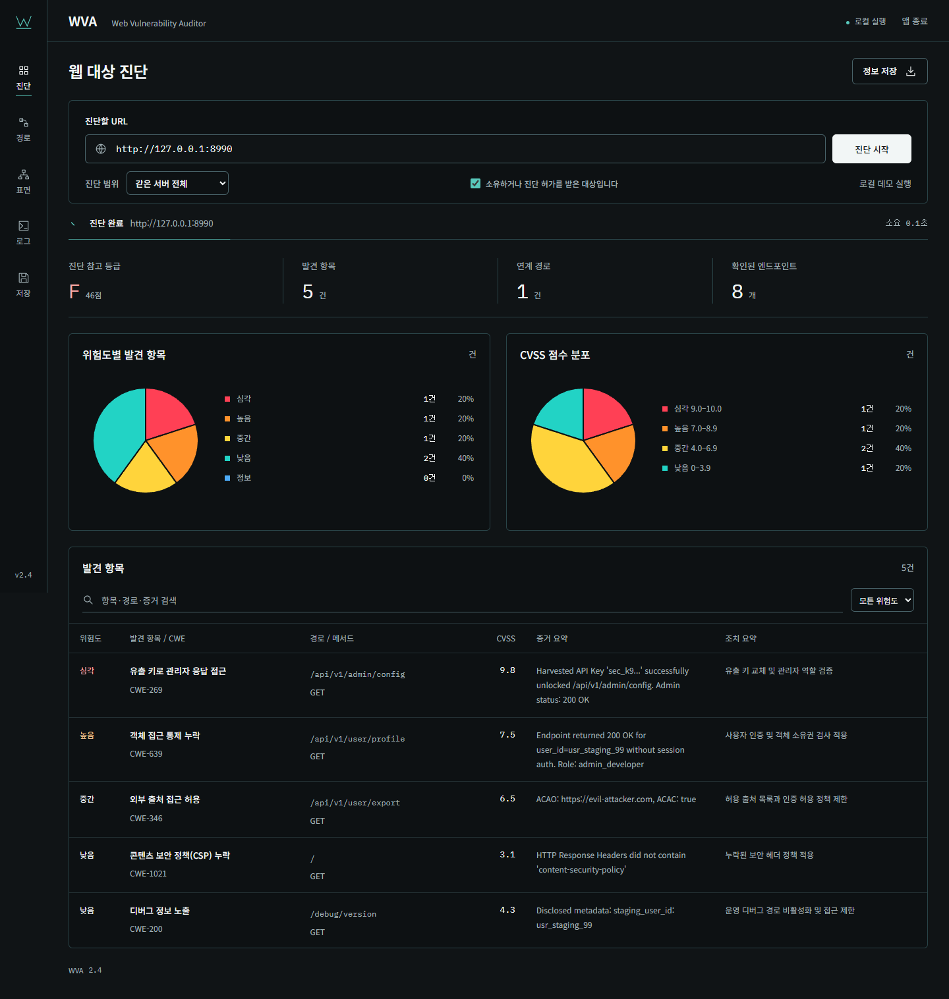
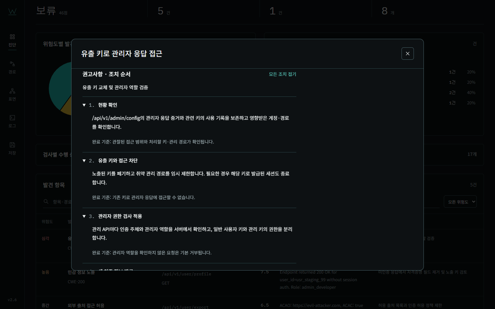

# WVA 프로젝트 결과보고서

웹 취약점 진단 도구와 Windows 대시보드 구현 결과

작성일 2026년 11월 3일 · 구현 버전 2.1.0 · 검증 기록 기준 2026년 11월 1일

## 1 프로젝트 개요와 주요 성과

WVA는 사용자가 입력한 웹 서버를 대상으로 제한된 취약점 규칙을 실행하고, 발견 항목의 증거와 연계 경로를 확인한 뒤 결과를 저장하는 로컬 진단 도구다. 기존 Python 분석 엔진에 Windows 단독 실행파일과 한국어 대시보드를 연결하여, 명령어 없이 대상 입력부터 보고서 저장까지 진행할 수 있도록 구현했다.

기록된 검증 결과는 기능 테스트 48건, 실행파일 검사 21건, 브라우저 작업 흐름 검사 22건 모두 통과다. 이는 서로 다른 검증 목록의 합계 91건이며, 외부 운영 서비스의 탐지율이나 전체 웹 취약점에 대한 정확도를 뜻하지 않는다. 취약 실습 대상에서는 발견 항목 5건과 3단계 연계 경로 1건을 확인했고, 방어 프로필에서는 현재 규칙에 해당하는 발견 항목과 경로가 0건이었다. [S1][S2]

| 구분 | 결과 |
| --- | --- |
| 제공 형태 | Windows x64 실행파일과 로컬 웹 대시보드 |
| 주요 사용 흐름 | 대상 입력 → 진단 → 증거 및 연계 경로 확인 → 선택 저장 |
| 주요 화면 | 진단, 경로, 공격 표면, 로그, 저장 |
| 결과 형식 | JSON, Markdown, UTF-8 BOM CSV |
| 테스트 환경 | Windows 10 x64, Python 3.12.14, 로컬 취약 및 방어 대상 |
| 기준 커밋 | b00bd597a4ce599e6540a8b5f4b174bd94374143 |
| 저장소 | https://github.com/User-shin0328/WVA |

직접 대상 입력, 공통 상세 창과 순서형 조치 안내를 중심으로 화면을 정리했다. 측정한 응답과 문서에서 발견한 경로를 구분하고, 진단별 로그와 선택 보고서를 보존한다. 실행파일은 소스 없이 한글 경로에서 동작을 확인했다. [S2]

본 보고서는 프로젝트의 구현 결과를 설명한다. 이후 제시하는 취약점 수치는 의도적으로 구성한 로컬 실습 대상의 결과이며, WVA 프로젝트 자체에서 발견된 취약점 수치가 아니다. 이번 문서 작성에서는 기존 검증 원본과 현재 소스 및 실행파일 해시를 대조했으며, 새 운영 대상 진단은 수행하지 않았다.

<!-- pagebreak -->

## 2 시스템 구성과 진단 처리

### 2.1 구성 요소

| 구성 | 역할 | 주요 위치 |
| --- | --- | --- |
| 실행기 | 브라우저 열기, 포트 선택, 기존 서버 재사용, 저장 위치 결정 | launcher.py |
| 대시보드 서버 | 진단 시작과 중단, 상태 조회, 로그, 다운로드 API | dashboard/server.py |
| 화면 | 입력, 원형 차트, 발견 표, 공통 상세 창, 저장 선택 | dashboard/static/ |
| 분석 엔진 | 표면 탐색과 각 검사 모듈의 실행 순서 관리 | agents/engine.py |
| 상태와 경로 | 발견 항목 및 수집 정보 공유, 연계 그래프 구성 | core/graph/ |
| 보고서 | 상세 조치 생성, 자동 보고서와 선택 내보내기 | reporting/ |
| 검증 환경 | 취약 및 방어 대상, 기능·실행파일·브라우저 검사 | tests/ |

FastAPI와 Uvicorn은 로컬 서비스를 제공하고, httpx는 대상 요청을 수행한다. Pydantic은 입력과 데이터 모델을 검증하며, Beautiful Soup는 HTML 링크와 폼을 분석한다. NetworkX는 발견 항목의 전제 조건과 결과를 연결하는 그래프를 구성한다. PyInstaller는 화면과 폰트를 포함한 실행파일을 만든다. [S3][S4]

### 2.2 처리 순서

1. **표면 탐색** — 정해진 경로와 HTML 링크·폼·OpenAPI 문서에서 엔드포인트를 수집한다. 응답 코드, 콘텐츠 유형, 시간, 크기, 수집 시각과 출처를 기록한다.
2. **설정 검사** — 루트 응답의 보안 헤더와 쿠키 속성, 대상 경로의 CORS 응답 및 일부 디버그 경로의 정보 노출을 검사한다.
3. **객체 접근 검사** — 수집한 식별자 또는 제한된 후보를 사용해 정해진 프로필 경로를 확인한다. 응답의 사용자 식별자와 역할 또는 키 필드를 함께 확인한다.
4. **연계 경로 분석** — 수집한 키로 정해진 관리자 경로의 응답을 확인하고, 식별자·키·권한 상태를 연결해 경로를 생성한다. [S4]

### 2.3 요청과 실행 상태 관리

대상 요청은 정확한 스킴·호스트·포트 안에서 GET·HEAD로 제한하며 리다이렉트를 자동 추적하지 않는다. 위험 경로와 인코딩된 경로를 검사하고 TLS 인증서 검증을 활성화했다. 대시보드의 로컬 Host·Origin 검사와 JSON 요청 제한도 적용했다.

동시에 하나의 진단만 실행한다. 완료·실패·중단을 구분하고, 완료 전 다운로드와 이전 진단 ID로 저장하는 요청을 차단한다. 진행 단계는 실제 로그를 사용한다. 화면 갱신은 상태 조회로 처리하며, 별도의 SSE 이벤트 API는 구독자별 커서와 최근 이벤트 재전송을 지원한다. [S4]

<!-- pagebreak -->

## 3 대시보드 구현 결과

어두운 배경, 흰색 글씨와 청록색 선을 적용했다. 소개 문구와 지표 옆 부가 설명, 우선 조치 패널을 제거하고 대상 입력과 발견 결과에 집중하도록 정리했다. 위험도 및 CVSS 분포는 선명한 색의 원형 차트로 표시한다. 건수와 비율은 실제 결과를 집계하며 0건 분류는 조각을 만들지 않는다.



그림 1 로컬 취약 실습 대상의 진단 화면. 상단의 대상 입력, 결과 지표와 위험도·CVSS 원형 차트를 보여준다. 원본 전체 화면에는 발견 항목 표가 이어진다. 화면 수치는 실습 데이터다.

| 화면 | 구현한 작업 |
| --- | --- |
| 진단 | 주소 입력, 진행 및 완료 모션, 차트, 검색·위험도 필터, 증거·조치 요약 표 |
| 경로 | 대상 입력 → 연계 경로 → 관련 발견 항목 배치, 단계별 상세 창 열기 |
| 공격 표면 | HTTP·메서드·매개변수·응답 시간·크기·출처·헤더 및 미측정 정보 표시 |
| 로그 | 진단 활동과 진단별 JSONL 및 앱 오류 로그의 실제 저장 위치 표시 |
| 저장 | 저장 정보 설명, 포함할 항목 선택, JSON·Markdown·CSV 형식 선택 및 다운로드 |

상세 창은 작업 영역 너비의 약 75%, 화면 높이의 75%로 구성했다. 위험도·CVSS·CWE·증거와 조치 순서를 표시하며 경로 화면에서 열어도 현재 화면을 유지한다. 1440·768·390px 화면의 문서 가로 넘침, 상세 창과 저장 화면을 확인했고, 시스템의 모션 감소 설정을 반영했다. [S2][S5]

<!-- pagebreak -->

## 4 작동 검증과 오류 수정 결과

### 4.1 검증 환경과 결과

검증은 Windows 10 x64 한 대와 로컬 실습 서버에서 수행했다. 기능 테스트 원본은 2026년 11월 1일 03시 14분경, 실행파일 검사는 03시 14분경, 브라우저 검사는 03시 16분경 기록이다. 통합 결과 문서는 같은 날 03시 18분경 갱신되었다. 시간 기준은 한국 표준시다. [S2]

| 검증 구분 | 결과 | 주요 확인 내용 |
| --- | --- | --- |
| 기능 테스트 | 48 / 48 PASS | 요청 경계, 탐지 조건, 상태 전이, 로그, 보고서, 저장 검증 |
| 실행파일 검사 | 21 / 21 PASS | 한글 경로의 exe 단독 실행, 내장 자산·데모, 종료와 포트 해제 |
| 브라우저 검사 | 22 / 22 PASS | 직접 진단, 차트, 상세 창, 화면 유지, 반응형, 실제 파일 다운로드 |

기능 검사는 다른 출처와 위험 경로 차단, 잘못된 주소 거부, 중복 시작·중단·연결 실패 처리, SSE 다중 구독과 재전송을 포함한다. 선택 내보내기는 완료 상태·현재 진단·빈 선택·중복 선택을 검사하고, CSV의 쉼표와 줄바꿈 보존 및 수식 해석 방지를 확인했다.

실행파일은 소스 없이 한글 경로에서 검증했다. 두 번째 실행 시 기존 서버 재사용, 이벤트 구독 중 종료, 종료 코드 0과 포트 해제를 확인했다. 브라우저 검사에서는 차트 합계와 5건의 발견 항목 일치, 6단계 조치 표시, 세 가지 파일 다운로드, 외부 자산 요청 0건과 JavaScript 예외 0건을 기록했다. 마지막 두 수치는 해당 브라우저 검사에서 관찰한 범위다.

### 4.2 확인된 문제와 반영한 수정

| 문제 | 반영 내용 | 확인한 결과 |
| --- | --- | --- |
| 초기 exe 시작 시 Illegal byte sequence | 런타임이 요구하는 TLS 인증서 정책 파일을 패키지에 포함 | 동일 해시의 exe를 한글 경로에서 독립 실행 |
| frozen 환경의 데모 실행 방식 | 자기 exe를 Python처럼 실행하는 방식 대신 소유한 서버를 프로세스 안에서 관리 | 내장 데모 실행과 종료 통과 |
| 일반 200 응답의 과도한 판정 | BOLA는 사용자 값·민감 필드, 관리자 접근은 privilege 필드를 추가 확인 | 일반 export 상태를 BOLA로 보고하지 않음 |
| 구독과 종료 처리 | 구독자별 이벤트 커서와 종료 신호 처리 | 다중 구독·재전송·구독 중 정상 종료 통과 |

보조 디자인 검사에는 작은 글자 비중과 차트 색상 수 등에 대한 경고가 남아 있다. 자동 기능 통과와 별도로 읽기 편의성 개선 대상으로 관리한다. [S2]

<!-- pagebreak -->

## 5 로컬 진단에서 확인한 결과

### 5.1 취약 프로필과 방어 프로필 비교

| 대상 프로필 | 엔드포인트 | 발견 항목 | 연계 경로 | 판정 범위 |
| --- | ---: | ---: | ---: | --- |
| 취약 프로필 | 8 | 5 | 1 | 의도한 정보 노출·객체 접근·관리자 응답 연결 확인 |
| 방어 프로필 | 4 | 0 | 0 | 현재 검사 규칙에 해당하는 항목이 보고되지 않음 |

취약 프로필과 방어 프로필은 서로 다른 테스트 구성이므로 이 수치만으로 전체 취약점의 조치율이나 탐지 정확도를 계산할 수 없다. 방어 프로필의 0건 역시 전체 서비스 안전 판정이 아니다. [S1][S2]

### 5.2 취약 프로필 발견 항목

| 발견 항목 | 경로 | 위험도 | 참고 점수 |
| --- | --- | --- | ---: |
| 유출 키로 관리자 응답 접근 | /api/v1/admin/config | 심각 | 9.8 |
| 객체 접근 통제 누락 | /api/v1/user/profile | 높음 | 7.5 |
| 임의 출처와 인증 허용 CORS | /api/v1/user/export | 중간 | 6.5 |
| 디버그 정보 노출 | /debug/version | 낮음 | 4.3 |
| 콘텐츠 보안 정책 누락 | / | 낮음 | 3.1 |

디버그 응답에서 테스트 사용자 식별자가 노출되고, 프로필 경로에서 같은 식별자와 역할 및 키가 반환되었다. 이후 수집 키를 사용한 요청에서 관리자 경로가 HTTP 200과 ADMIN 상태를 반환했다. CORS 항목은 테스트 Origin 반사와 인증 허용 헤더를 함께 관찰한 결과다. 실제 사용자 세션을 이용한 브라우저 데이터 유출은 수행하지 않았다.

위험도 분포는 심각 1·높음 1·중간 1·낮음 2·정보 0건이다. CVSS 점수 구간은 9.0~10.0에 1건, 7.0~8.9에 1건, 4.0~6.9에 2건, 0.0~3.9에 1건이다. 디버그 항목은 규칙의 위험도가 낮음이고 점수가 4.3이므로 두 차트의 분포가 다르다. 점수와 위험도는 기존 규칙의 참고값이며 환경별 CVSS 재평가 결과가 아니다.

### 5.3 공격 표면 관찰

독립 실행 검증에서 8개 엔드포인트 중 7개는 응답 메타데이터가 있고 1개는 문서·폼에서 발견했으나 미측정이었다. 탐색 시 응답은 200 다섯 개, 422 한 개, 403 한 개였고 미측정 한 개가 별도로 표시되었다. 프로필의 422는 매개변수 없이 탐색했을 때의 응답이며, 후속 식별자 요청의 200과는 요청 조건이 다르다.

응답 시간과 크기는 해당 요청의 관찰값이다. 성능 부하 시험의 지연 분포나 서비스 처리량으로 해석하지 않는다. [S2]

<!-- pagebreak -->

## 6 연계 경로와 조치 안내

### 6.1 확인한 연계 흐름

1. **디버그 정보 노출** — /debug/version에서 테스트 사용자 식별자를 수집했다.
2. **객체 접근 통제 누락** — /api/v1/user/profile에 해당 식별자를 전달하여 사용자 정보와 키를 관찰했다.
3. **관리자 응답 접근** — 수집 키를 X-API-Key로 전달하여 /api/v1/admin/config의 ADMIN 응답을 확인했다.

그래프는 각 항목이 요구하는 식별자·키 유형과 산출 정보를 연결한다. 이 실습에서는 각 단계의 응답 근거가 있으나, 일반 환경에서는 같은 유형의 서로 다른 값이 연결될 수 있어 값의 출처와 권한 조건을 추가 검토해야 한다. 확인된 최종 범위는 관리자 설정 응답의 조회이며 시스템 전체 제어, 데이터 변경 또는 임의 코드 실행을 검증한 결과는 아니다. [S4]

### 6.2 항목별 순서형 조치 안내



그림 2 관리자 응답 접근 항목의 조치 순서 화면. 창 안에서 스크롤하여 나머지 단계와 재검증 조건을 확인한다.

관리자 항목은 다음 6단계로 안내한다. **현황 확인 → 유출 키와 접근 차단 → 관리자 권한 검사 적용 → 새 인증 정보 발급 → 상위 노출 경로 정리 → 재검증** 순서다. 각 단계에 실행 내용과 완료 기준이 있으며, 마지막에 폐기 키·일반 사용자·허가된 관리자 요청의 결과를 비교하도록 안내한다.

디버그 노출, 객체 접근, CORS, CSP, HSTS 등은 문제 유형에 맞는 별도 절차를 사용한다. 상세 창과 자동 보고서, 선택 저장은 같은 조치 데이터를 사용하여 순서를 일치시켰다. 이 기능은 권고 절차를 제시하며 대상 서버의 설정을 자동 수정하지 않는다. [S5]

<!-- pagebreak -->

## 7 제공 산출물과 재현 근거

### 7.1 실행 및 보존 파일

| 산출물 | 내용 |
| --- | --- |
| WVA.exe | 화면·폰트·내장 데모가 포함된 Windows 단독 실행파일 |
| docs/BUILD_INFO.json | 버전, 크기, 해시와 검증 건수 |
| tests/TEST_GUIDE.md | 준비 순서, 명령, 예상 결과, 판정 기준과 실제 결과 |
| tests/TEST_RESULTS.md | 기능·실행파일·브라우저 검증의 상세 결과 |
| tests/lab/ | 취약 및 방어 비교 대상 |
| reports/ 및 logs/ | 완료 보고서와 진단별 JSONL 및 앱 오류 로그 |

실행파일 크기는 26,134,820바이트이며 2026년 11월 3일 확인한 SHA-256은 아래와 같다. 빌드 정보와 실행파일 검증 원본의 해시와 일치한다. [S2][S3]

`9f660e29c52abff80c9c8317e1046f0cc4222299e9165282b1b2e935e8266ca4`

자동 완료 보고서는 exe 옆 reports/에 Markdown과 JSON으로 저장한다. 활동 로그는 logs/scans/의 진단별 JSONL에 추가 기록하며 실행 오류는 logs/WVA.log에 남긴다. 쓰기 권한이 없으면 %LOCALAPPDATA%/WVA/를 사용한다. 선택 저장은 요약·발견 항목·경로·엔드포인트·로그 중 필요한 정보를 지정한다.

### 7.2 재현 방법

프로젝트 루트에서 다음 순서로 테스트 환경을 준비하고 검증할 수 있다. 브라우저 검사는 tests/TEST_GUIDE.md에 적힌 Node·Playwright·브라우저 환경과 실행 중인 대시보드 및 로컬 대상이 추가로 필요하다.

```powershell
powershell -ExecutionPolicy Bypass -File .\tests\Setup-TestEnvironment.ps1
.\.venv\Scripts\python.exe -m tests.run_tests
.\.venv\Scripts\python.exe -m tests.smoke_executable
node tests/ui_check.cjs
```

### 7.3 근거 자료

- [S1] [테스트 상세 설명](../tests/TEST_GUIDE.md) — 환경 구축, 기대값과 재현 절차.
- [S2] [테스트 결과보고서](../tests/TEST_RESULTS.md) — 실제 수행 시각, 항목별 결과와 원본 산출물 위치. 로컬 원본은 tests/artifacts/의 pytest.xml, executable-smoke.json, browser/result.json이다.
- [S3] [README](../README.md), [빌드 정보](BUILD_INFO.json), [폴더 분석](PROJECT_ANALYSIS.md) — 사용·배포·구현 범위.
- [S4] [엔진](../agents/engine.py), [표면 수집](../surface/recon.py), [경로 그래프](../core/graph/attack_graph.py), [서버](../dashboard/server.py) — 실제 처리와 상태 관리.
- [S5] [조치 데이터](../reporting/remediation.py), [선택 저장](../reporting/selected_export.py), [화면](../dashboard/static/app.js) — 순서형 안내와 내보내기.

<!-- pagebreak -->

## 8 한계점과 보완사항

### 8.1 현재 한계점

**진단 범위가 제한되어 있다.** 고정 경로, 제한된 식별자 후보와 JSON 필드명을 사용하는 휴리스틱 검사다. 전체 사이트 크롤링, 로그인 후 탐색, 일반화된 API 권한 검증과 모든 OWASP 항목을 지원하지 않는다. 반사 검사 파일은 존재하지만 기본 엔진에 연결되지 않아 XSS·SQL 주입 탐지를 구현 성과에 포함하지 않는다.

**인증과 소유권을 충분히 대조하지 못한다.** 현재 객체 접근 판정은 미인증 응답의 식별자와 민감 필드를 확인한다. 서로 다른 실제 계정과 조직의 세션을 비교하지 않으므로 공개 데이터와 비공개 데이터의 구분, 수평·수직 권한 분리는 운영 환경에서 별도 확인해야 한다.

**연계 경로의 연결 근거가 유형 중심이다.** 그래프는 user_id, api_key 같은 유형을 연결한다. 여러 값과 여러 계정이 있는 환경에서 정확히 같은 값이 다음 단계에 사용됐는지 보장하는 추적 모델은 부족하다. 표시되는 차단점은 각 단계의 수정 후보이며 비용과 효과를 수학적으로 최적화한 최소 차단 결과가 아니다.

**위험도와 점수의 근거가 단순하다.** CVSS 점수는 규칙에 정해져 있고 환경별 벡터 계산을 제공하지 않는다. 일부 항목의 위험도와 점수 구간이 다르며, 예를 들어 CSP 누락 규칙의 CWE 분류도 재검토가 필요하다. 헤더 관찰만으로 실제 브라우저에서의 악용 가능성이나 피해 규모를 확정할 수 없다.

**완료 상태가 모든 검사의 성공을 뜻하지 않는다.** 개별 검사 중 일부 예외는 로그만 남기거나 건너뛴다. 전체 흐름이 끝나면 완료로 표시할 수 있어, 네트워크 오류 때문에 확인하지 못한 항목과 정상적으로 문제없음을 확인한 항목이 충분히 구분되지 않는다. GET·HEAD 제한과 위험 경로 목록도 대상의 부작용이 전혀 없음을 보증하지 않는다.

**증거 보관과 이력 기능이 제한적이다.** 화면 데이터는 메모리에 있어 앱을 재시작하면 복원하지 않는다. 파일은 남지만 이전 진단 비교나 조치 상태 추적 기능은 없다. 활동 로그에서 키 값을 가리더라도 구조화된 보고서의 증거와 산출 정보에 키·식별자가 포함될 수 있다. 암호화 저장, 접근 권한, 자동 보존·폐기 정책과 위변조 방지 감사 체계는 추가 작업이 필요하다.

**운영 환경과 배포 검증이 부족하다.** Windows 10 x64 한 대와 통제된 로컬 대상에서만 검증했다. 별도 Windows 11 장비, 백신별 반응, 기업 프록시·인증서, 대규모 사이트와 장시간 실행은 미검증이다. 현재 exe의 Authenticode 상태는 NotSigned다. 한글 경로 실행 통과를 모든 PC의 실행 보장으로 확대할 수 없다.

**가독성과 접근성 개선이 남아 있다.** 작은 글자 비중에 대한 디자인 경고가 있다. 색상 외에 범례와 수치를 제공하지만, 스크린리더·고대비 모드·키보드만 사용하는 전체 작업 흐름에 대한 별도 접근성 검증은 완료되지 않았다.

<!-- pagebreak -->

### 8.2 보완 우선순위와 완료 기준

아래 항목은 후속 개발 제안이다. 현재 구현 및 테스트 통과 범위에 포함하지 않는다. 일정과 담당자는 정하지 않았으며, 완료 기준을 통과한 항목부터 지원 범위에 추가한다.

#### 우선 1 결과 신뢰성과 증거 보호

- **부분 실패 표시** — 검사별 성공·실패·미실행 상태와 사유, 시도 수를 기록한다. 시간 초과를 강제로 발생시켰을 때 해당 검사가 미확인으로 표시되고, 전체 결과에서 확인 범위를 알 수 있어야 한다.
- **기본 마스킹과 보관 정책** — 키·토큰·쿠키·개인 식별정보를 화면과 JSON·Markdown·CSV 전체에 일관되게 마스킹한다. 원본 증거는 별도 접근 통제와 보존 기간을 적용한다. 비밀 테스트 값을 넣었을 때 일반 저장 파일에서 원문이 발견되지 않아야 한다.
- **판정 근거 정비** — 위험도, CWE, CVSS 벡터와 참고 점수의 관계를 검토한다. 헤더 누락, 잠재 위험, 응답 접근 확인을 구분하고 각 항목에 신뢰도와 재현 조건을 표시한다. 동일 근거가 화면과 모든 저장 형식에 일치해야 한다.

#### 우선 2 권한 검사와 연계 정확도

- **다중 계정 권한 대조** — 허가된 본인·타인·다른 조직·관리자 세션을 등록하고 기대 권한과 실제 응답을 비교한다. 정상 공개 리소스를 취약점으로 보고하지 않으며, 계정별 비허용 접근을 별도로 식별해야 한다.
- **값과 출처를 추적하는 그래프** — 수집 값의 출처, 요청 ID, 계정, 사용 단계와 결과를 연결한다. 같은 유형의 서로 다른 키를 넣은 테스트에서 잘못된 연계가 생성되지 않아야 한다.
- **수집 범위와 요청 예산** — 허용 경로, 최대 깊이, 요청 횟수, 속도 제한과 응답 크기 제한을 추가한다. 상한 도달 시 중단 사유와 확인하지 못한 범위를 남기고, 부작용 가능 경로는 명시적으로 제외할 수 있어야 한다.

#### 우선 3 운영 편의성과 배포 품질

- **이력과 재검증** — 저장 결과를 다시 불러오고 동일 대상의 전후 차이를 비교한다. 해결·재발·미확인 상태를 구분하고, 재시작 후에도 진단 ID와 근거 파일의 연결이 유지되어야 한다.
- **환경 검증과 서명 배포** — 별도 Windows 10·11 장비, 보안 제품과 네트워크 환경에서 실행·종료·저장을 검증한다. 코드 서명, 배포 해시, 의존성 취약점 검사와 자동 회귀 검증을 구축한다. 서명 검증과 환경별 검사 결과가 배포 버전에 연결되어야 한다.
- **읽기 편의성과 접근성** — 표와 상세 창의 기본 글자 크기·대비·포커스를 개선한다. 390px 화면, 확대 보기, 키보드와 스크린리더로 대상 입력부터 저장까지 완료할 수 있어야 한다.

후속 운영 검증에서는 탐지 결과를 독립적으로 판정한 기준 데이터와 비교하고, 오탐·미탐·부분 실패를 각각 집계해야 한다. 현재의 91건 검증 통과 기록은 기능 회귀 기준으로 유지하되, 운영 대상에 대한 신뢰도 평가는 별도의 근거로 축적한다.
